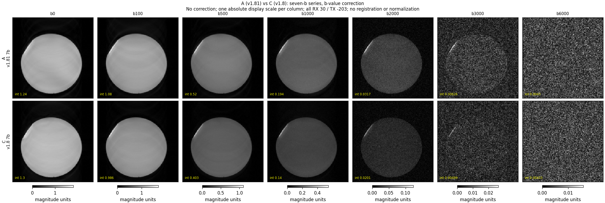
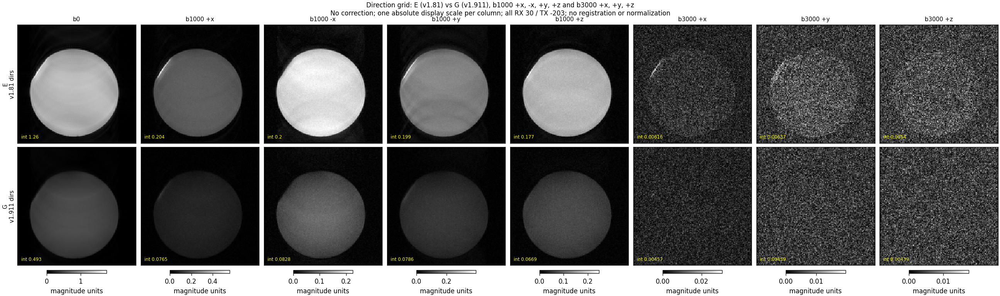
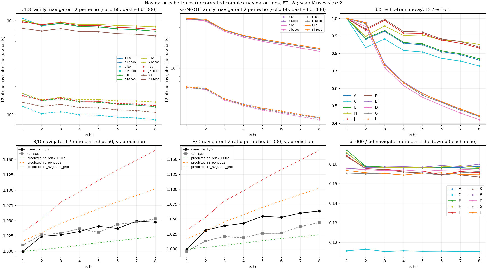
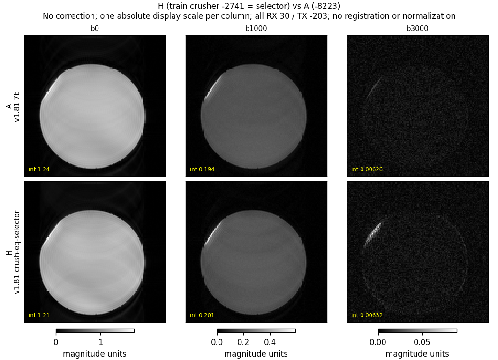
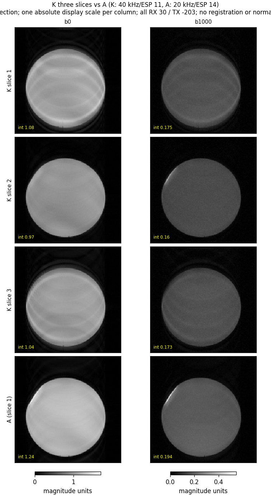
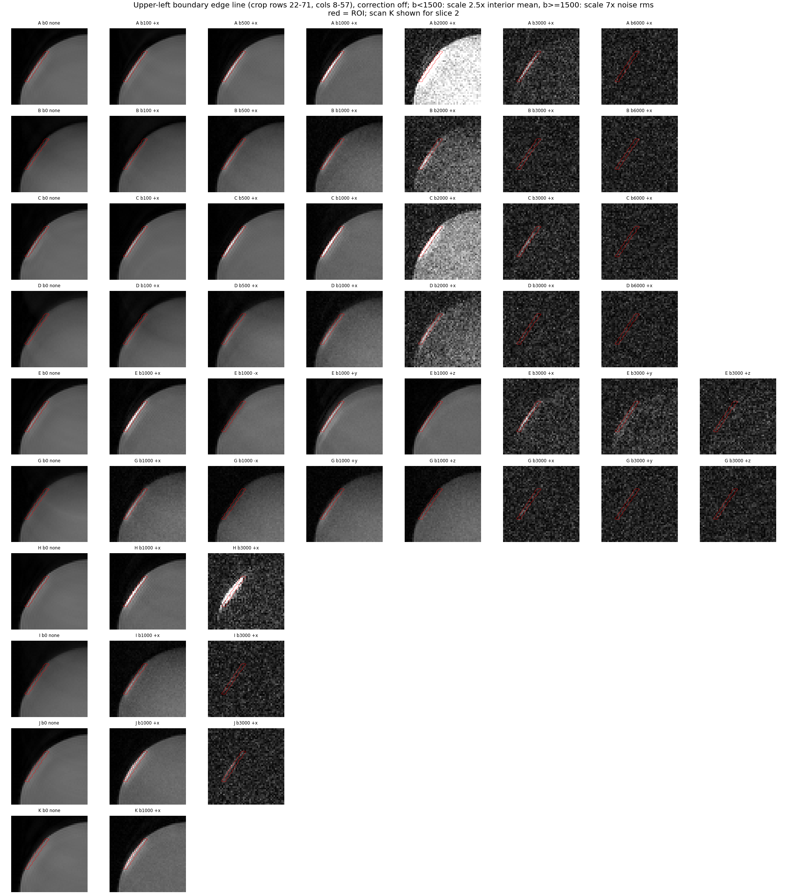

# Physical scanner experiments — October 10, 2026

**v1.81 does what it was built to do.** Its b-value correction is confirmed on the scanner. With the modelled effective b-values, v1.8, v1.81, v1.91 and v1.911 give the same water ADC, **1.849–1.862 ×10⁻³ mm²/s**. That is a 0.7% spread, using the navigator echo-train median. With the typed b-values, v1.8 reads 2.159 and v1.81 reads 1.843, so v1.8 is about 17% high, as predicted.

Flipping the diffusion polarity (+x vs −x) no longer changes the signal in v1.81: they agree within 0.3%. Image quality, high-b cleanliness and echo centring are the same as v1.8. **v1.911 also passes its main test.** Its later echoes are brighter than v1.91, by 0% at echo 1 rising to +4.8% at echo 8. Its b-values, ADC and high-b floor are unchanged.

**Three new problems showed up. None is a reason to go back to v1.8, but each must be fixed before the sequences are "reliable".**

1. **v1.81 at b = 0: the first echo is slightly wrong.** It is about 4.5% weaker and about 6–10° out of phase relative to the rest of the train. This appears only at b = 0, in all five v1.81 scans, and never in v1.8. Any b ≥ 100 removes it. The most likely cause is an unwanted signal pathway. The old in-pair read prephaser used to spoil it, and moving the prephaser left it unspoiled.
2. **The slice (z) axis gives 12.5% less b1000 signal than x or y, in both v1.81 and v1.911.** That is about 74 s/mm² of extra diffusion weighting, roughly twice the modelled 37 s/mm² cross term. It matters for any multi-direction (DTI) work.
3. **Multi-slice v1.81 has phase errors in the off-centre slices.** The unplanned scan K was the first multi-slice acquisition in this project. Its two off-centre slices show ±25–45° odd/even echo phase errors and arc artefacts. Its centre slice is 15–17% darker than the single-slice equivalent (J).

**The sample was a water phantom, not the planned fixed rat brain.** The images are a uniform disk, and the signal reaches the noise floor by b3000. The [10-09 plan](../experiments/2026-10-09_exvivo_plan/README.md) assumed tissue, so its tissue-specific questions remain unanswered. These include the high-b behaviour of real tissue, the benefit of short-T2 timing (Δ30, ESP 11) and white-matter anisotropy. Please confirm the sample and the temperature. If the phantom is pure water, the ADC of 1.85×10⁻³ mm²/s implies about 16–17 °C; it was 1.83–1.87 on 10-07.

The [catalog](../experiments/scan_catalog_2026-10-10.md) lists every parameter, the chronology and the plan deviations. Numbers below come from the scripts listed under [Reproduction](#reproduction-and-verification).

## What was acquired

Ten scans ran in letter order over 35 minutes: A, B, C, D, E, G, H, I, J, K. **F (v1.8 polarity) was skipped. K (three-slice v1.81) was added.** A was not re-run, so there is no drift repeat.

All scans used RX 30 / TX −203 (−195 on 10-07), ETL 8, centric ordering, TR 2000 ms and a single 1-mm slice at isocentre, except K. The embedded protocols match the planned PPRs exactly, except J and K. Both were changed on the console to 40 kHz bandwidth (25 µs dwell) and ESP 11 ms. K also has three slices at −1.2/0/+1.2 mm and only b0/b1000. I ran at Δ30 / TE 44 as planned and was accepted. No v1.911 hang or rejection occurred, and all 55 volumes are complete.

| Scan | Sequence | Purpose | Notable settings |
|---|---|---|---|
| A | v1.81 | Main seven-b dataset | b 0/100/500/1000/2000/3000/6000 |
| B | v1.911 | Main ss-MGOT seven-b | ESP 13 |
| C | v1.8 | Control for A | identical to A except PPL |
| D | v1.91 | Control for B | ESP 14 |
| E / G | v1.81 / v1.911 | Directions | b0; b1000 +x, −x, +y, +z; b3000 +x, +y, +z |
| H | v1.81 | Train crusher equal to the slice selector | crusher −2741 (vs −8223) |
| I | v1.911 | Shorter preparation | Δ30, TE 44 |
| J | v1.81 | Bandwidth | 40 kHz, ESP 11 |
| K | v1.81 | Multi-slice (unplanned) | 3 slices, 40 kHz, ESP 11, b0/b1000 |

Metrics come mainly from the **navigator echoes**: one unencoded echo train per volume, with noise-subtracted amplitude per echo. They also come from the mean of a fixed interior image ROI (radius 34 px) with correction off. Background, rim and edge-line ROIs are shown in the [ROI figure](figures/physical_scanner_2026-10-10/roi_placement.png). All 59 saved NIfTI slice-volumes are reproduced from raw k-space to 2.6–4.1×10⁻⁸, and the independent verifier passes.

## 1. v1.81: b-value correction confirmed



| | v1.8 (C) | v1.81 (A) | Prediction | Test-plan pass band |
|---|---:|---:|---|---|
| Navigator b1000/b0, echoes 2–8 (median) | 0.1155 | **0.1583** | 0.116–0.119 / 0.158–0.161 | v1.81 0.150–0.168 ✔ |
| Same, echo 1 only | 0.1157 | 0.1655 | — | (inflated by the b0 echo-1 deficit, §2) |
| v1.81 / v1.8 ratio (echoes 2–8) | | **1.371** | 1.36 | 1.30–1.42 ✔ |
| Image interior b1000/b0 | 0.1083 | 0.1573 | | |
| ADC, nominal b (×10⁻³ mm²/s) | 2.159 | 1.843 | ratio 0.86 | 0.82–0.90 ✔ (0.854) |
| ADC, effective b | **1.855** | **1.849** | equal | within 3% ✔ (0.3%) |
| b6000 | noise floor | noise floor | floor | ✔ |
| Echo-peak centroid (samples) | 64.89–64.99 | 64.89–64.99 | 64.7–65.2 | ✔ |

The per-echo ratios show the mechanism directly. **At b ≥ 100, v1.81/v1.8 is flat across all eight echoes**: 1.11 at b100 and 1.37–1.38 at b1000. That is what a pure change in diffusion weighting looks like. b100 rises by 1.11 against a predicted 1.10, from effective b 153 → 100. A seven-b log-linear fit with effective b is monoexponential for both sequences, with a plateau fraction ≤3×10⁻⁵.

ss-MGOT, measured with its own effective b, gives the same water ADC: 1.852 (v1.911) and 1.862 (v1.91). This is the first time the four sequences agree quantitatively. **v1.8 data should never be pooled with the others by typed b-value.**

Reproducibility across days is good. v1.8 b1000/b0 was 0.1157 today vs 0.1155 on 10-07 (test1). Its effective ADC was 1.853 vs 1.867 (10-07 test1b). v1.91 b1000/b0 was 0.1576 vs 0.1606 (10-07 test2).

## 2. New v1.81 problem: echo 1 at b = 0

At b0, v1.81's echoes 2–8 are identical to v1.8's (A/C = 1.000–1.011). **Echo 1 is 4.4% lower.** Its phase is shifted by +9° relative to the b>0 echo (E: +10°, H: +6°), and the odd/even phase alternation grows from about ±1° to about ±7°. The same pattern appears in every v1.81 scan (A, E, H, J, K): echo-1 b1000/b0 is 0.164–0.167 against 0.156–0.158 for echoes 2–8. v1.8 shows none of it (0.1157 vs 0.1155, phase shift 1°).

Practical consequences:

* **A low b0 inflates every b/b0 ratio taken from echo 1 or from a centric image**, because echo 1 fills the centre of k-space. The effective-b ADC from echo 1 is 1.805, 2.4% low. A's b100 point looks 4% too bright, giving b0–b100 "ADC" 1.40 instead of 1.85. This would masquerade as an IVIM/perfusion effect in tissue.
* The image b0 is 4.6% dimmer than v1.8, which is just outside the test plan's "b0 SNR within 3%" criterion.

**Likely mechanism (hypothesis, not proven).** In v1.8 the read prephaser sat between the excitation and the diffusion 180. It put about 2,075 cycles/m of read-axis dephasing on any signal created at the diffusion 180, about 73 readout samples. That pushed such signal out of the acquisition window at every b, including b0. v1.81 removed that dephasing, which was the point of the change. At b0, a pathway such as the free induction decay from the edges of the diffusion-180 slice profile now lands on echo 1. It is attenuated only by the slice crusher. Any diffusion lobe moves it far off the echo again; even b10 would give about 2,600 cycles/m.

The pre-scan physics review dismissed the model's "slice-incoherent histories, worst −2.9% of E1" as a box-profile artefact ([review_physics §7.1](v181_v1911/review_physics.md)). Today's −4.4% suggests that effect was real.

**Fixes, cheapest first.**

1. Use a small nonzero b (about 10 s/mm²) as the reference volume. Effective b is then about 14 and the water attenuation of 1.8% is known. Test b0/5/10/20 to confirm the echo-1 defect disappears.
2. In code, add a fixed, balanced spoiler pair around the diffusion 180 that does not depend on b, or enforce a minimum diffusion moment.

Until one is in place, fit v1.81 data with echoes 2–8 or exclude the b0 point from low-b fits.

## 3. Polarity and directions



b1000 signal relative to +x (navigator / image):

| Direction | v1.81 (E) | v1.911 (G) | v1.81 model |
|---|---:|---:|---:|
| −x | **0.997** / 0.983 | 1.018 / 1.082 | 1.000 |
| +y | 1.004 / 0.980 | 1.020 / 1.028 | 1.000 |
| +z | **0.875** / 0.869 | **0.873** / 0.875 | 0.936 |

* **Polarity independence in v1.81 is confirmed** (−x/+x 0.997). For comparison, v1.8 is modelled at effective b 1176 vs 842 for ±x, about 1.85× brighter on −x in water. F was skipped, so that was not shown directly today. v1.911 has a small −x excess of 1.8% that no model covers.
* **The z deficit is the same in both sequences.** Since water is isotropic, the slice axis carries about 74 s/mm² of extra b, twice the modelled cross term. Two causes are possible: a cross term with the slice-select/crusher gradients, which changes sign with polarity, or a z gradient calibration error of about 3.5%, which does not. Without a −z volume they cannot be separated. For DTI this would bias anisotropy and tensor orientation, so it must be calibrated before any multi-direction tissue work.

## 4. v1.911 (ss-MGOT, ESP 13) vs v1.91 (ESP 14)



| Echo | 1 | 2 | 3 | 4 | 5 | 6 | 7 | 8 |
|---|---:|---:|---:|---:|---:|---:|---:|---:|
| B/D measured, b0 | 0.999 | 1.024 | 1.027 | 1.032 | 1.041 | 1.037 | 1.049 | 1.048 |
| B/D measured, b1000 | 0.999 | 1.031 | 1.039 | 1.043 | 1.055 | 1.053 | 1.060 | 1.063 |
| Model, no relaxation | 1.000 | 1.002 | 1.006 | 1.010 | 1.014 | 1.017 | 1.020 | 1.024 |
| Model, T2 60 ms | 1.017 | 1.030 | 1.045 | 1.057 | 1.069 | 1.081 | 1.091 | 1.102 |

The test-plan criteria are met: echo 1 ≥ 1.00 within noise, essentially monotonic, echo 8 ≥ 1.03, results inside the bracket, b1000/b0 equal (0.1577 vs 0.1576) and b6000 at the floor. The gain is close to what one would expect from simply arriving 1 ms per echo earlier, given the observed train decay of about 110 ms. That supports "same pathways, less time". The echo-8/echo-1 ratio at b0 is 0.442 vs 0.421.

**The basic ss-MGOT cost has not changed.** v1.911's b0 echo 1 is **36% of v1.8's** (3756 vs 10574 raw units). At matched effective b1000, it is 35% of v1.81. Its train still decays more steeply: echo 8/echo 1 is 0.44 vs 0.76.

What ss-MGOT is supposed to buy is immunity to motion-induced phase errors. **That benefit has still not been tested**, because a static water phantom has no such errors. Today's data therefore show that v1.911 is a strictly better ss-MGOT than v1.91. They do not show that ss-MGOT is worth its signal cost.

## 5. Protocol levers: Δ30 (I), crusher = selector (H), 40 kHz / ESP 11 (J)

**I, v1.911 with Δ30 / TE 44.** The console accepted it. Navigator b0 is +1.7–2.9% per echo compared with B, and b1000/b0 is unchanged (0.1567 vs 0.1577). Water diffusion does not depend on diffusion time, so this is expected. The small gain reflects water's long T2. The predicted +37% applies to tissue with T2 about 32 ms and is still untested.

The image interior b0 is 7% lower than B. This comes from a different shading pattern, not from less signal: B has a bright central blob that I lacks (see the [figure](figures/physical_scanner_2026-10-10/I_vs_B.png)). Shading in ss-MGOT varies from scan to scan by several percent, as it did on 10-07.

**H, train crusher −2741 (equal to the slice selector).**



* H keeps more of the echo train: b0 echo 8/echo 1 is 0.851 vs 0.761. Diffusion weighting is unchanged (echoes 2–8 b1000/b0 0.158).
* **At b3000, H grows a faint rim around the whole phantom.** The edge-line artefact (§7) is 2.5× brighter, and k-space readout-edge power is 1.38× higher.
* This repeats the 10-04 lesson: weak train crushers let unwanted pathways back in at high b. A crusher equal to the selector is not clean enough on its own. The "merged crusher" route to a shorter ESP would need either an intermediate amplitude, tested at b6000, or a design that keeps the full crusher area.

**J, 40 kHz bandwidth, ESP 11 (vs A: 20 kHz, ESP 14).** It behaves as expected:

* The noise is 1.42–1.47× higher, against the predicted √2. Image SNR is 0.70–0.84× of A.
* The train is flatter: echo 8/echo 1 is 0.830 vs 0.761, because the echoes come 3 ms sooner.
* Edge width is unchanged in water (1.66 vs 1.69 px). In tissue with T2 about 35 ms the shorter ESP would sharpen the image noticeably. At echo 8 it reaches the receiver 21 ms earlier, roughly 1.8× more late-echo signal.
* The echo-1 b0 deficit appears here too.

## 6. Multi-slice v1.81 (K)



| | Slice 1 (−1.2 mm) | Slice 2 (centre) | Slice 3 (+1.2 mm) |
|---|---|---|---|
| b0 navigator echo phases, E1–E4 (°) | −46, −136, −81, −119 | 154, 143, 144, 140 | −7, 66, 3, 41 |
| Odd/even phase alternation | **about ±40°** | about ±5° (normal) | **about ±30°** |
| Image | Strong arc artefacts | Clean; 17% darker than J at b0 | Strong arc artefacts |
| b1000/b0 (echo 1) | 0.162 | 0.165 | 0.167 |

Interpretation:

* **Off-centre slices break the CPMG phase relation.** Odd and even echoes are tens of degrees apart. With centric ordering, odd and even echoes fill interleaved k-space bands, which produces the arcs.
* The usual cause is an RF frequency offset for off-centre slices that is not matched by a phase correction on each refocusing pulse. The phase then drifts with the time between pulses. All earlier scans were single-slice at isocentre, so this inherited v1.8 code path has never been exercised. It is not a v1.81-specific bug.
* The centre slice loses 15–17% to slice crosstalk. Its 1-mm neighbours sit 0.2 mm away and their 180 pulses partly saturate it.
* **Multi-slice is mandatory for useful in-vivo coverage, so this is a blocker.** v1.911 rejects multi-slice altogether (E3).

## 7. The bright edge line is a sample artefact



A one-pixel bright line sits along the flattened upper-left boundary of the disk. That flat chord is probably an air bubble or meniscus.

* **Where it appears:** clearly in A, C, E, H, J and K's centre slice, weakly in B, D, G and I. It is about 2.5× the interior at b1000.
* **How it decays:** more slowly than water (0.27 of its b0 at b1000 vs 0.157), reaching the noise by b6000. It is not a plateau like Alsop's on 10-07.
* **Polarity dependence:** it is strongly polarity-dependent (E b1000 rms: +x 0.37, −x 0.14).

That combination is the signature of a **susceptibility background gradient at an air–water interface**. It adds a cross term to the diffusion gradient with opposite sign for ±x, and the read-direction distortion piles signal into one pixel. It is not a sequence fault. It does preview **in-vivo air–tissue interfaces**, such as the sinuses and ear canals, where the same direction-dependent bias will appear. The standard remedy is to acquire ±directions and combine them by geometric mean. **Degas or tap out the bubble before the next session.**

## 8. Where each version stands (all sessions)

| Version | Status after 10-10 | Main evidence |
|---|---|---|
| v1.8 | Reference only, superseded | Typed b-values wrong by +17% at b1000 and polarity-dependent; otherwise stable since 10-05 (negative constant crushers, PE1) |
| **v1.81** | **Recommended base for ex-vivo / static samples** | Correct b; polarity-independent; same signal and cleanliness as v1.8; b0 echo-1 defect and multi-slice phase need fixing |
| v1.91 | Superseded by v1.911 | Clean high b; about 36–40% of v1.8 b0 echo-1 signal (10-10 / 10-07) |
| **v1.911** | Best ss-MGOT build; **in-vivo candidate only if motion robustness pays for 2.8× less signal** | +0–5% over v1.91; single slice, isocentre only |
| v1.92 (Alsop) | Drop | 10-07: high-b plateau about 8% of b0 (unwanted pathway) |

## Reproduction and verification

From the repository root:

```text
python docs/data/oct10_protocol_audit.py
python docs/data/physical_scanner_analysis_2026-10-10.py
python docs/data/oct10_attenuation_analysis.py
python docs/data/oct10_echo_consistency.py
python docs/data/verify_physical_scanner_2026-10-10.py
```

Outputs:

* Measurements: [image](data/oct10_image_measurements.csv), [navigator per echo](data/oct10_navigator_echoes.csv), [k-space](data/oct10_kspace_measurements.csv)
* Analyses: [pair comparisons](data/oct10_pair_comparisons.csv), [attenuation fits](data/oct10_attenuation_fits.json), [directions](data/oct10_direction_ratios.csv), [echo consistency](data/oct10_echo_consistency.json)
* Checks: [protocol audit](data/oct10_protocol_audit.md), [independent verification](data/oct10_independent_verification.json)
* Contact sheets: [7-b](figures/physical_scanner_2026-10-10/contact_7b_A_C_B_D.png), [directions](figures/physical_scanner_2026-10-10/contact_8vol_E_G.png), [H/I/J](figures/physical_scanner_2026-10-10/contact_3b_H_I_J.png), [K](figures/physical_scanner_2026-10-10/contact_K_slices.png)

The raw data were read only.

**Limits:**

* The effective b-values are source-model traces, not measured waveforms. I and J/K reuse the Δ40 / 50 µs tables, and the v1.911 −x/y/z terms are assumed equal to v1.81's.
* There is no drift repeat, and the sample temperature is unknown.
* The bandwidth-ESP comparison (J) co-changes two parameters.
* Scan timing (test-plan Item 4: +5 ms per shot) and off-resonance robustness (Item 7) were not measured.

---

## Plain-language breakdown and next steps

### What today showed, in one paragraph each

**v1.81 is a real fix.** The old sequence (v1.8) quietly applied about 17% more diffusion weighting than you typed. The amount depended on which way the gradient pointed. v1.81 removes that. Measured with the corrected b-values, all four sequences now give the same water diffusion value to within 1%. Measurements from v1.81 can be trusted at face value, which was never true for v1.8.

**But v1.81 has a small new glitch at b = 0.** Only the very first echo is affected, and it is about 4–5% too weak. The cause is probably a stray signal that the old misplaced gradient used to hide. It disappears as soon as any diffusion gradient is on. It is small, but it lands exactly on the b0 image that every ADC calculation divides by. The simple workaround is to use b ≈ 10 as the "zero" image.

**v1.911 is a better version of ss-MGOT, but ss-MGOT is still expensive.** Late echoes are up to 5% brighter than v1.91, as designed, and nothing got worse. But ss-MGOT still delivers only about a third of the signal of v1.81. Its whole reason to exist, tolerating motion in living animals, has not been tested yet, because a still water bottle cannot test it.

**Three things block in-vivo use.**

* **Multi-slice:** imaging more than one slice with v1.81 corrupts the off-centre slices, and v1.911 cannot do multi-slice at all.
* **Slice axis:** diffusion along the slice axis is over-weighted by about 7%, which would bias any multi-direction (DTI) map.
* **Motion:** motion robustness has not been tested.

**Some knobs work and some don't.** A faster readout (J) behaves exactly as physics predicts: noisier but a flatter echo train, which is good for tissue. Shortening the diffusion time (I) works on the scanner; its benefit only shows in tissue. A weaker train crusher (H) brings back faint high-b contamination, so the "merged crusher" shortcut to a shorter echo spacing isn't free.

### Recommended next steps (in order)

**Session 1: finish the ex-vivo sequence (fixed brain, the plan from 10-09).** Use the brain this time, degassed, and note the temperature.

1. **v1.81 reference-volume test (5 min).** Run b = 0, 5, 10, 20, 1000 on v1.81, plus b0 and b1000 on v1.8. Confirm that the echo-1 defect disappears at small b, and adopt b ≈ 10 as the reference.
2. **Axis calibration (10 min, water or PBS region).** Run v1.81 at b500 and b1000 on ±x, ±y and ±z. The ± average gives the true per-axis b, and the ± difference gives the cross term. Derive the per-axis correction for the b-matrix.
3. **Run the planned tissue core with v1.81 as the main sequence:** A-style seven-b, E-style directions with the ±z pair added, and I's Δ30/TE44 equivalent on v1.81 if accepted. Also run J's 40 kHz / ESP 11 for the short-T2 benefit. Finish with a repeat of the first scan to check drift.
4. Keep one v1.911 seven-b (B) for the first real-tissue high-b comparison.

**Code work before in vivo.**

5. **Fix multi-slice phase in v1.81.** Make each refocusing pulse's RF phase follow the slice frequency offset, with phase-continuous offsets. Increase the slice gap or interleave to cut crosstalk. Re-test with K's protocol: the outer slices should show odd/even phase within ±5°.
6. **Permanent b0 fix in v1.81.** Add a b-independent spoiler pair around the diffusion 180, or a minimum diffusion moment, if the b≈10 workaround proves to be a nuisance.
7. Model the larger z cross term (or measured calibration) into the b-matrix tables.

**Session 2: decide the in-vivo sequence.** This is the most important open question.

8. **Motion-phase challenge.** Single slice at isocentre, v1.81 vs v1.911, same b-values and several repeats. Use either a deliberately vibrating or flowing phantom, or an anaesthetised animal pilot. Measure the shot-to-shot signal dropouts and the image-to-image variability, not just the mean.
   * If v1.81 is stable enough: choose **v1.81 with multi-slice and per-shot phase handling**. The held "navigator in every shot" item becomes the priority.
   * If v1.81 drops out: choose **v1.911**. It then needs multi-slice support, and Δ30 / shorter TE to recover signal in short-T2 tissue.
9. Retire v1.8 (except as a historical control) and v1.92 (Alsop). Do not pursue the crusher-equals-selector shortcut without a b6000 test at an intermediate amplitude.

**Bottom line:** v1.81 is close to a reliable **ex-vivo** sequence. It needs the b0 workaround, axis calibration and one real-tissue session. The **in-vivo** choice between v1.81 and v1.911 depends on one experiment that has not been run yet: the motion test. Both sequences need multi-slice work before full-brain in-vivo imaging.
