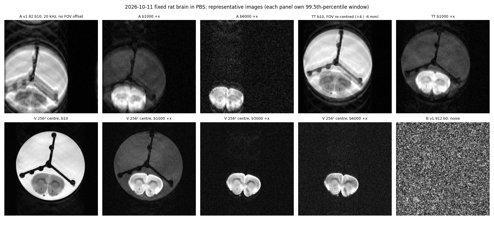
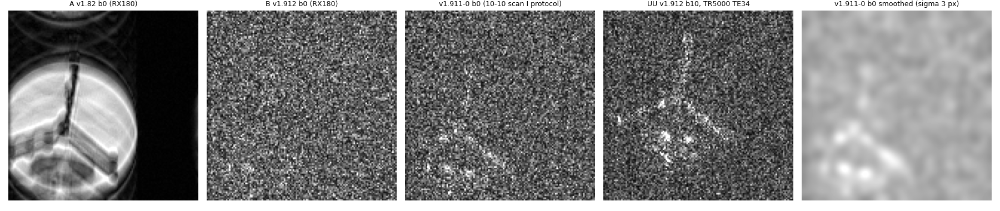
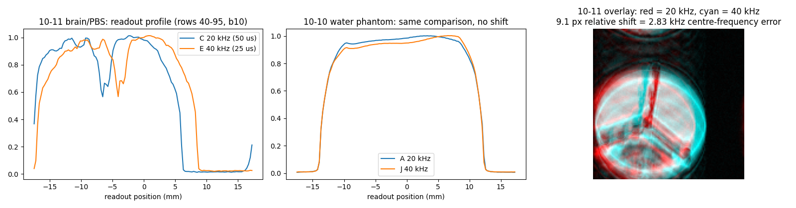
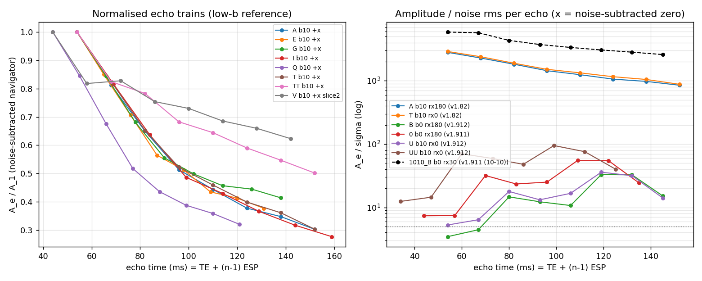
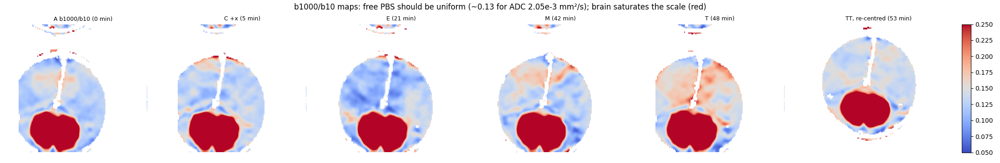
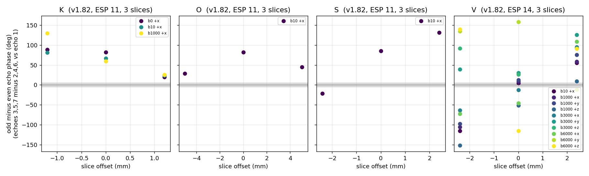
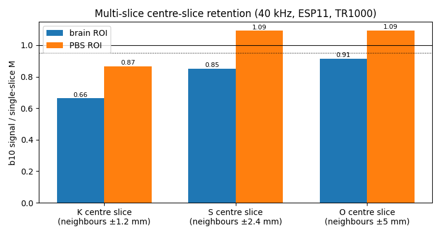
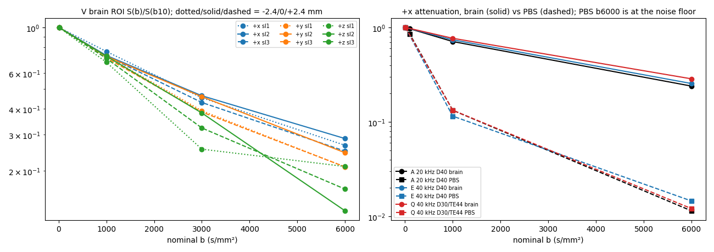
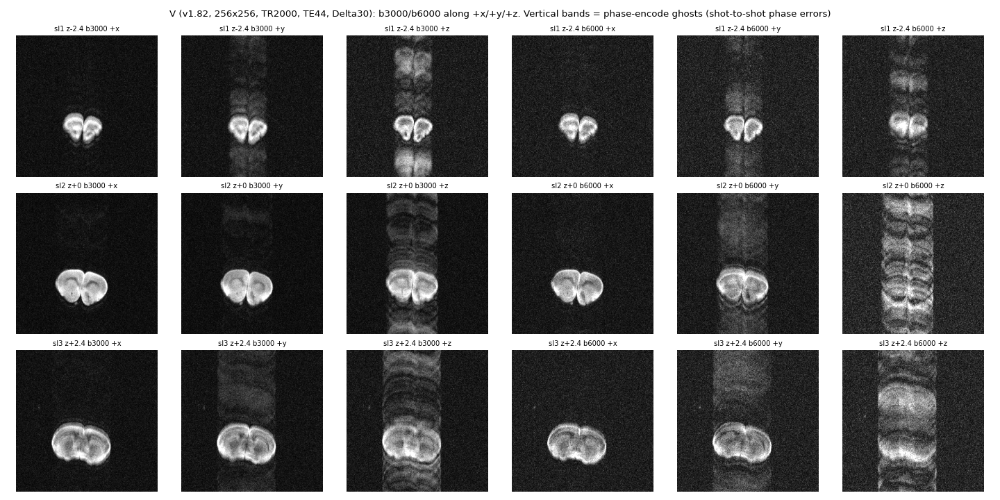
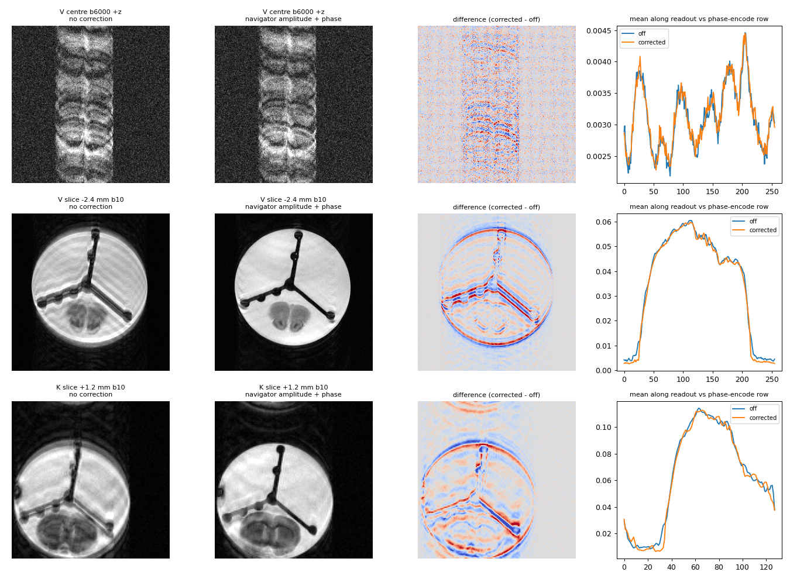

# Physical scanner experiments — October 11, 2026

**The fixed rat brain session produced a usable v1.82 dataset, including a 256×256 three-slice pilot (V). Two session-level problems dominate today's results, and both have to be fixed before any of the planned quantitative tests can be trusted.**

1. **The scanner centre frequency was about 2.8 kHz off resonance for the whole session.** Every 40-kHz image is displaced 9.1 px along the readout relative to the matching 20-kHz image; on 10-10 the same comparison gave 0.2 px. This error alone explains why **every ss-MGOT scan (v1.912 *and* the unchanged v1.911) gave noise**. ss-MGOT's 3-mm preparation slab and 1.67-mm tip-up pulses have a lower bandwidth per millimetre than the imaging pulses, so a 2.8-kHz error moves them 5.5 mm and 2.0 mm away from the imaging slice. No prepared magnetization is left in the slice, and ss-MGOT's built-in two-cycle twist then cancels the unprepared magnetization by design. v1.82's pulses all shift together, so it survived. **v1.912 has therefore not actually been tested yet.**
2. **TR 1000 ms is too short for this sample.** All TR-1000 scans (every scan except V, v1.911-0 and UU) show a ±30–50° odd/even echo-phase alternation (10-10 at TR 2000: ±1–6°). They also show a fast-decaying echo train and spatially patchy, unstable PBS signal. Together these limit image-based PBS measurements to about ±5–10% repeatability. The only v1.82 TR-2000 scan, V, has a near-perfect CPMG centre slice (±2–5°). This is the leading explanation, but V also changed several other parameters, so it is not yet proven.

**New v1.82-specific finding: the off-centre RF phase fix does not work on the scanner.** Off-centre slices now show a steady phase ramp of about **35° per echo per mm of slice offset**: ±50°/echo at ±1.2 mm and ±70–110°/echo at ±2.4 mm. v1.81 on 10-10 had no ramp at ±1.2 mm, only ±15–20° alternation. Off-centre-slice ADCs in PBS read about 20% high. Multi-slice v1.82 is therefore still a blocker.

**What worked:**
- **Tissue contrast.** v1.82 gives clean fixed-brain diffusion contrast. Brain ADC is 0.31–0.33 ×10⁻³ mm²/s, and it is isotropic within 3% in V's centre slice. About 25–29% of the brain signal remains at b6000, kurtosis is about 0.9, and SNR is about 9 at b6000 at 256².
- **High b in PBS.** PBS reaches the noise floor at b6000 along x in every scan, so there is no high-b contamination there.
- **Protocol levers.** All minimum-ESP protocols were accepted, and 40 kHz costs the expected 1/√2 in SNR. Δ30/TE44 gives 10% more brain SNR at b10 and 38% more at b6000.
- **Mixed-axis direction.** The (1,1,1) direction (AB) runs.

**What failed:**
- **High-b ghosting along z and y.** At b3000–6000, V's z (and y) volumes carry strong phase-encode ghosts, 20–35% of the brain signal, while x stays at 3%. This is shot-to-shot phase instability in a *static* sample. It is precisely the problem that per-shot navigators (nav mode 2, still not runnable on the scanner) and ss-MGOT are meant to solve.

The [catalog](../experiments/scan_catalog_2026-10-11.md) lists every parameter, the chronology and the plan deviations. Numbers below come from the scripts listed under [Reproduction](#reproduction-and-verification). Four parts of the analysis (protocol audit, navigator echoes, effective-b model, ss-MGOT forensics) were run by separate agents and spot-checked against the raw data.

## What was acquired

Nineteen scans were run over 72 minutes in this order: A, B, C, v1.911-0, AB, E, G, I, M, K, O, Q, S, T, U, TT, V, UU, N. **Fifteen were v1.82; B, N, U and UU were v1.912; v1.911-0 was the unchanged 10-10 scan-I protocol, run as a diagnostic after B failed.** Because ss-MGOT failed, the v1.912 partners D, F, H, J, L, P and R were skipped, as were Z/AA (off-resonance) and AC. AD (the 128² alternative) was not run, since V was acquired. The W/X/Y guard-rejection outcomes were not recorded; please note whether each rejected as expected.

| Scan | Sequence | Purpose | Notable settings |
|---|---|---|---|
| A | v1.82 | Low-b sweep + tissue baseline | b 0/5/10/20/100/1000/6000 +x, 20 kHz, ESP14 |
| B | v1.912 | ss-MGOT counterpart of A | ESP13 — **noise** |
| C | v1.82 | Axis/polarity calibration | b10, ±x ±y ±z at b500 and b1000, b10 |
| v1.911-0 | v1.911 | Unplanned diagnostic: 10-10 scan I protocol | TR2000 TE44 Δ30, b0/1000/3000 — **noise** |
| AB | v1.82 | Mixed axis | b1000 along (1,1,1)/√3, 40 kHz |
| E / G / I | v1.82 | ESP minimum and +1 ms | 40 kHz ESP11 / 40 kHz ESP12 / 20 kHz ESP15 |
| M | v1.82 | Single-slice reference for K/O/S (nav2 not available) | 40 kHz ESP11, b10/1000 |
| K / S / O | v1.82 | Three slices at ±1.2 / ±2.4 / ±5 mm | 40 kHz ESP11 |
| Q | v1.82 | Shorter diffusion preparation | Δ30 / TE44, b10/1000/6000 |
| T / U | v1.82 / v1.912 | Drift repeats of A / B | b10/1000 — U **noise** |
| TT | v1.82 | Unplanned: T with in-plane FOV offset | read +4.0, phase −6.0 mm |
| V | v1.82 | Final ex-vivo pilot | 256², 3 slices ±2.4 mm, TR2000, TE44, Δ30, b10 + 3 dirs × b1000/3000/6000; 12.4 min |
| UU / N | v1.912 | Unplanned rescue attempt / single-slice reference | UU: TR5000, TE34, Δ20, FOV offset — **noise** |

**Gains:** RX gain was 180 for A, B, C and v1.911-0, then 0 from AB onward; nothing records the change. TX gain was −129 throughout (−203 on 10-10). The RX 180 → 0 change makes the planned drift pairs A/T and B/U ratio-only comparisons. The ss-MGOT receiver noise matches v1.82 at the same RX gain to within 3%, so the receiver is not the cause of the ss-MGOT failure.

**Nav mode 2 was not acquired.** All scans ran with the volume navigator (`nav_on=1`), because the console-compatible PPR copies replaced nav 2 as a workaround. M/N, K/O/S and Q are therefore not per-shot navigator tests.



**Sample.** The images show the planned fixed rat brain (coronal) at the bottom of a PBS-filled tube, held by a three-spoke holder. The tube sits about 4 mm below isocentre along the phase-encode axis. With no in-plane offset, the bottom of the tube therefore wraps into the top of the 35-mm FOV, and at 20 kHz the frequency error also pushes the left edge out of the readout window. From TT onward the operator added read +4.0 mm / phase −6.0 mm offsets, which re-centred the image and cut the ghost/wrap signal outside the object from about 11% to 3–5%. Temperature (operator, after the session): the brain came out of the fridge about 45 minutes before the first scan and its tube was refilled with fresh room-temperature PBS, so the bath was a little below room temperature and the brain was probably still colder and warming during the session. A cold specimen in a warmer bath drives slow convection in the PBS, which fits the patchy, changing PBS maps in §2. It does not explain the 2.8-kHz frequency error, since 15–20 °C moves the water line by only about 80 Hz.

**Methods in brief.** The analysis uses:
- **Reconstruction:** plain centric-reordered FFT with no navigator correction, from the MRDs (C, G, I and Q have no reconstruction in their folders).
- **ROIs:** a brain ROI and a free-PBS ROI drawn automatically from the b1000/b10 ratio map (brain 0.6–0.8, PBS about 0.13). The PBS ROI excludes the wrap rows, the clipped edge and a 4-px rim ([ROI figure](figures/physical_scanner_2026-10-11/roi_placement.png)).
- **Signals:** noise-corrected √(mean I² − 2σ²), with σ from the k-space periphery.
- **Navigators:** per-volume echo trains, noise-subtracted.
- **Effective b:** echo-1 b-matrix traces from the event model, now resolved for all 19 scans. The reconstruction sidecars had fallen back to nominal b. For v1.82 the b10 → b1000 trace difference is 986.4 s/mm² along x/y, so effective and nominal ADCs differ by only 0.4% except along z.

## 1. Why ss-MGOT gave noise: a 2.8-kHz frequency error



**What the data show**

| | v1.82 A (RX 180) | v1.912 B (RX 180) | v1.911-0 (RX 180) | v1.912 U / N (RX 0) | v1.912 UU (TR5000, TE34) | 10-10 v1.911 B/G/I (water) |
|---|---:|---:|---:|---:|---:|---:|
| Navigator echo-1 amplitude / noise | ~250 | 3.5 | 7.4 | 5.3 / 4.2 | 12.4 | ~5900–6100 (RX 30) |
| Echoes 3–8 / noise | 70–200 | 10–33 | up to 60 | up to 37 | up to 95 | |
| b-dependence of the residual signal | normal | **none** (b0 ≈ b6000) | **none** | **none** | — | normal |
| Image contrast (object/outside) | 9 | 1.0 | 1.1 | 1.0 | 1.0 | |

- The residual ss-MGOT signal is weak, **independent of b**, and grows along the train (echoes 1–2 at noise, echoes 3–8 above it). That is the signature of magnetization that was never diffusion-prepared, regrowing during the variable-flip refocusing train. It is not attenuated prepared signal.
- **v1.911-0 is byte-identical to the 10-10 scan I protocol, which worked**, apart from the gains. The repository PPL files match their recorded hashes. Whatever broke ss-MGOT is therefore not the v1.912 code changes.
- TR does not separate pass from fail (TR 1000, 2000 and 5000 all fail). The receiver noise is normal, and the same sample gives strong v1.82 signal. That rules out the sample, TR and the receiver.

**The frequency error.** An image shifts along the readout by Δf ÷ (bandwidth/128). A fixed-Hz error therefore displaces a 20-kHz image twice as far as a 40-kHz one. Today every 40-kHz scan registers to the 20-kHz scans with a +9.1-px readout shift and 0.0 px along phase encode, for all eight 40-kHz scans (AB, E, G, M, K, O, Q, S). On 10-10 the identical comparison (v1.81 J vs A) gave 0.2 px.



The shift gives Δf ≈ 9.1 × 312.5 Hz ≈ **2.83 kHz** (sign unresolved; about 7 ppm at 400 MHz). At 20 kHz the image is displaced about 4.9 mm. This is why the PBS disk is clipped at the left edge of all 20-kHz scans, and part of why the operator needed a +4-mm read offset. The carrier frequency is not stored in the MRD (`OBSERVE_FREQUENCY` is 0 in every file), so this inference cannot be checked directly. **Please check how the frequency was set today: auto-adjust on the wrong peak, a stale value, or a field drift after a ramp.**

**Why it kills ss-MGOT but not v1.82.** A frequency error moves each slice-selective pulse through-plane by Δf × width / pulse bandwidth. The bandwidths come from the PPL pulse definitions:

| Pulse | Width | RF bandwidth | Shift at 2.83 kHz | Relative to imaging slice | Overlap with 1-mm imaging slice |
|---|---:|---:|---:|---:|---:|
| v1.82 excitation / refocusing | 1 mm | same shape | 0.94 mm | 0 | 1.00 |
| ss-MGOT imaging / re-excitation | 1 mm | 1283 Hz | 2.21 mm | — | — |
| ss-MGOT prep 90/180 slab | 3 mm | 1109 Hz | 7.66 mm | **5.45 mm** | **0** |
| ss-MGOT tip-up | 1.667 mm | 1109 Hz | 4.25 mm | **2.05 mm** | **0** (5% profile) |

With neither the prep nor the tip-up reaching the imaging slice, that slice contains only unprepared longitudinal magnetization. ss-MGOT deliberately imposes two cycles of dephasing across the slice (`v19_cycles=2`) that only the prepared magnetization is unwound from, so the unprepared signal integrates to zero. Only the regrowth seen in later echoes survives. Full coverage of the imaging slice is lost above roughly ±0.5 kHz, and the overlap vanishes completely by 1.0–2.5 kHz, depending on the pulse and the profile definition.

Two other causes were considered and are ranked lower:
- **A scanner-side change to the ss-MGOT RF libraries or PPL.** It would hit only ss-MGOT, but nothing points to it. Test: hash the `g:\J_Figger\seqlib\v19_*` files.
- **A B1 problem at the new TX gain** (−203 → −129, units undocumented). The v19 pulses have three times the amplitude headroom of v1.82's refocusing pulse, so clipping cannot explain the failure. Test: a TX ladder.

**Design consequence, independent of today:** ss-MGOT tolerates only about ±0.5 kHz of off-resonance before the prep and tip-up slabs start missing the imaging slice. In vivo at 9.4 T, B0 offsets near the sinuses and ear canals reach several hundred Hz, so ss-MGOT would lose signal regionally unless the prep and tip-up pulses are given the same bandwidth-per-millimetre as the imaging pulses. v1.82 has no such sensitivity.

## 2. TR 1000 ms with a PBS bath: echo-phase alternation and unstable PBS signal



Fitting each centred-slice navigator train as phase = ramp × echo + alternation × (−1)^echo:

| Scans | TR | In-plane offset | Odd/even alternation (half-amplitude) | Echo 8 / echo 1 (b10) |
|---|---:|---|---:|---:|
| A, C, E, G, I, M, Q, T and K/O/S centre slices (v1.82) | 1000 | none | **±30–66°** | 0.28–0.41 |
| TT (v1.82) | 1000 | +4 / −6 mm | ±24–26° | 0.50 |
| V centre slice (v1.82), b10 and b1000 x/y | 2000 | +4 / −6 mm | **±2–5°** | 0.62 |
| 10-10 v1.81 A, J, K centre (water) | 2000 | none | ±1–6° | 0.76 (water) |

A CPMG train should hold one phase. A large odd/even alternation means part of the magnetization is not aligned with the refocusing axis; that part oscillates and decays. The probable source is coherent residual magnetization from the previous TR: PBS has T1 ≈ 3 s and T2 well over a second, the train ends without a spoiler, and at TR 1000 that residue is still present when the next excitation arrives. The 10-10 water phantom was imaged entirely at TR 2000 and shows ±1–6°.

**Why this is the leading hypothesis but not yet proven:** V (the only TR-2000 v1.82 scan) also differs in matrix, dwell, TE/Δ and slice count. TT shows that the in-plane offset alone halves the alternation at TR 1000. That is also unexpected, because a read offset should only shift the receiver (the PPL applies it through receive frequency buffer 1). Possible reasons are that the shift moves the inter-TR coherences, or that synthesizer phase continuity is affected. Section 7 lists the decisive test.

**Consequences visible in today's data:**

* **The PBS is not uniform in the b1000/b10 maps.** Its ratio ranges from 0.08 to 0.20 within a single image, and the pattern changes from scan to scan. Free PBS should be flat at about 0.13. Convection in a warming bath would do the same, so both remain possible.

  

* **Repeats disagree.**
  * PBS b1000/b10 in the same ROI: A 0.133, C(+x) 0.127, E 0.115, M 0.140, T 0.163, TT 0.140.
  * Brain b1000/b10 in identical protocols: E 0.740 vs M 0.695.
  * The two bracketing b10 volumes of C differ by +6.9% in PBS (+1.4% in brain).
* **The low-b navigator test is inconclusive.** Navigator echo-1 ratios scatter by ±8% between consecutive low-b volumes in A, so the 4% v1.81 b0 echo-1 deficit can be neither confirmed nor excluded for v1.82. The image ROI is no better: brain b0/b10 is 0.95, but PBS b0/b10 is 1.07, the opposite sign.
* **The drift test cannot be scored.** A → T over 48 minutes gives brain b1000/b10 0.710 → 0.730 (+2.8%) and navigator 0.166 → 0.176 (+6%), but the RX gain changed in between and the TR-1000 scatter is of the same size.

## 3. v1.82 multi-slice: the off-centre phase fix fails, and magnetization transfer costs 10–15%



The odd/even metric in this figure (from the navigator analysis) is misleading for off-centre slices, because their phase *ramps* rather than alternates. Fitting the ramp ([oct11_slice_phase.csv](data/oct11_slice_phase.csv)):

| Scan | Slice offsets | Off-centre ramp (deg/echo) | Centre-slice ramp | 10-10 v1.81 K (±1.2 mm) |
|---|---|---:|---:|---:|
| K | ±1.2 mm | ±49–131 (aliased; about ±50) | 0.0–0.6 | **0 ramp**, ±11–20° alternation |
| S | ±2.4 mm | +82 / −81 | 0.1 | |
| V | ±2.4 mm (ESP 14) | 65–113 | −4 to +1 | |
| O | ±5 mm | +34 / −30 (aliased from about 170) | 0.5 | |

A ramp of 180°/echo is indistinguishable from pure alternation, so values near ±180 alias. The consistent picture is about **30–45° per echo per mm**, with opposite sign on each side of isocentre and independent of b. A steady per-echo ramp means each refocusing pulse's RF phase is off by a fixed amount that grows with the slice frequency.

v1.81 on 10-10 showed no ramp at ±1.2 mm. The ramp is therefore introduced by v1.82's new off-centre phase bookkeeping (`v182_step`, which assumes an offset-active window of `tsel90×10+1800` in 0.1-µs units). Either the window on hardware differs from the model, by roughly tens of µs per echo, or the correction's sign is reversed. The source-model check reported ≤0.21° error, so the model and the hardware disagree.

Effects:
- Off-centre PBS ADC reads 2.26–2.32 in V's outer slices against 1.83–1.97 in the centre.
- Outer-slice images carry stripe patterns in the PBS.
- Brain ADCs are less affected (0.27–0.38).

**Signal retention of the centre slice relative to single-slice M (b10, same readout):**



| Neighbours | Brain | PBS |
|---|---:|---:|
| ±1.2 mm (K) | 0.66 | 0.87 |
| ±2.4 mm (S) | **0.85** | 1.09 |
| ±5 mm (O) | 0.91 | 1.09 |

The brain loses signal at every spacing, while free PBS does not (within the ±7% TR-1000 scatter). That is the signature of **magnetization transfer**: the neighbouring slices' off-resonant RF saturates the macromolecular pool in tissue, and free water has no such pool. At ±1.2 mm direct slice overlap adds to it. MT is a property of multi-slice FSE, not a bug. It costs about 15% of tissue SNR at the planned 2.4-mm spacing, misses the plan's 95% retention target, and cancels in diffusion ratios as long as the slice geometry stays fixed.

## 4. Diffusion results

### Brain and PBS ADC

Effective-b ADCs, ×10⁻³ mm²/s, b10 → b1000 ([oct11_adc_fits.json](data/oct11_adc_fits.json)):

| Scan (TR) | Brain +x | Brain +y | Brain +z | PBS +x | PBS +y | PBS +z |
|---|---:|---:|---:|---:|---:|---:|
| **V centre slice (2000), Δ30** | **0.319** | **0.328** | **0.314** | **1.90** | **1.83** | **1.97** |
| C (1000), ± geometric mean | 0.319 | 0.355 | 0.378 | 2.04 | 2.01 | 2.01 |
| A (1000) | 0.347 | | | 2.05 | | |
| E / M (1000), 40 kHz | 0.305 / 0.369 | | | 2.19 / 1.99 | | |
| T / TT (1000) | 0.320 / 0.372 | | | 1.84 / 1.99 | | |
| Q (1000), Δ30 | 0.267 | | | 2.04 | | |
| AB, (1,1,1) direction | 0.338 (vs E's b10) | | | 1.97 | | |

* **Fixed brain:** about 0.32 ×10⁻³ mm²/s at b1000 in the cleanest acquisition (V centre), isotropic within ±2% across x, y and z. The ±10% direction differences in C and the 0.27–0.37 scatter between repeats are TR-1000 noise. They are not anisotropy, and they are not a diffusion-time effect (Q vs E).
* **PBS:** 1.90 ± 0.07 in V's centre slice and 1.84–2.19 across the TR-1000 scans. If the bath behaves like water, this means about 18–21 °C. It is higher than the 1.85 measured in water on 10-10, but the PBS spread is too large to read a temperature from.
* **Axis and polarity calibration (the main purpose of C) is not achieved today.** The ± geometric means agree across x, y and z to 1.5% at b1000 (2.04 / 2.01 / 2.01), which is consistent with no multiplicative axis error. The ± pairs, however, are dominated by noise:

  | | Predicted from model traces 1038 / 964 | Measured |
  |---|---:|---:|
  | +z/−z at b500 | 0.90 | 0.80 |
  | +z/−z at b1000 | 0.86 | 0.96 |
  | ±x, ±y pairs | 1.00 | 0.95–1.12 |

  The 10-10 z deficit therefore can be neither confirmed nor resolved. C must be repeated at TR ≥ 2000 with a stable, uniform PBS region.
* **The mixed-axis direction (AB) works.** It runs, its effective trace is 1020.8 s/mm² (vs 1000.8 along x), and its PBS attenuation matches M's +x within 2%. Note that the bvec writer normalises (577, 577, 577) to unit length, while the scanner plays 0.9993 of it.

### Non-Gaussian brain signal and high b



| | b1000 | b3000 | b6000 | Kurtosis fit D (×10⁻³) / K |
|---|---:|---:|---:|---|
| V centre, +x | 0.730 | 0.464 | 0.287 | 0.31 / 1.07 |
| V centre, +y | 0.723 | 0.459 | 0.245 | 0.30 / 0.73 |
| V centre, +z | 0.724 | 0.383 | 0.127 | not valid (ghosting, below) |
| A (20 kHz Δ40) +x | 0.710 | — | 0.240 | 0.37 / 0.96 |
| E (40 kHz Δ40) +x | 0.740 | — | 0.255 | 0.32 / 0.90 |
| Q (40 kHz Δ30) +x | 0.768 | — | 0.286 | 0.28 / 0.89 |

The brain signal is strongly non-monoexponential (K ≈ 0.9, typical of fixed tissue), with about 25–29% retained at b6000.

**PBS reaches the noise floor at b6000 along x in every scan:** the noise-corrected PBS signal at b6000 is 0.1–1.0 σ in A, E, Q and V (+x). The b6000 high-b cleanliness criterion is met in PBS along x, so the full train crusher is doing its job.

### High-b ghosting along z (and y)



Phase-encode ghost energy outside the object, relative to brain signal ([oct11_highb_ghosts.csv](data/oct11_highb_ghosts.csv)):

| V (all 3 slices) | +x | +y | +z |
|---|---:|---:|---:|
| b1000 | 2–4% | 5–7% | 6–9% |
| b3000 | 3% | 3–12% | **20–26%** |
| b6000 | 0–4% | 11–24% | **13–35%** |

In a static, fixed specimen, the z and y diffusion volumes at b ≥ 3000 replicate the brain along the phase-encode axis. The shot-to-shot phase is therefore not reproducible. Possible causes are gradient-induced vibration of the holder (z is usually worst) or diffusion-module phase that the CPMG train cannot tolerate. The ghosting removes brain signal from the ROI: V's +z b6000 brain ratio is 0.13 against 0.29 for +x. **This is exactly the failure mode that per-shot phase navigators (nav mode 2) and ss-MGOT exist to fix, and it appears ex vivo, not only in vivo.** With strong z gradients at Δ30, b6000 z and y data from v1.82 are not usable without them. A/E/Q along x are clean (3–7%).

## 5. Protocol levers

**Echo spacing and bandwidth.** Every minimum and minimum + 1 ms ESP was accepted by the console:

| Version | ESP accepted | Scans |
|---|---|---|
| v1.82, 40 kHz | 11 ms | E, M, AB, K, O, S, Q |
| v1.82, 40 kHz | 12 ms | G |
| v1.82, 20 kHz | 14 ms | A, C, T |
| v1.82, 20 kHz | 15 ms | I |
| v1.82, 40 kHz, 256 samples | 14 ms | V |
| v1.912, 40 kHz | 10 ms | N |
| v1.912, 20 kHz | 13 ms | B, U |

The measured echo peaks sit at 65.1–65.3 samples, with odd − even below 0.12 samples. One exception: V's echo 8 is about 3 samples (75 µs) late, which needs checking. Shot timing was not measured (no console durations recorded).

| | Brain SNR (b10) | PBS SNR (b10) | Note |
|---|---:|---:|---|
| A / T, 20 kHz ESP14 | 48.5 / 48.2 | 73.5 / 73.1 | |
| I, 20 kHz ESP15 | 43.4 | 70.2 | −10% vs T (+1 ms ESP) |
| E / M, 40 kHz ESP11 | 33.1 / 34.9 | 51.0 / 51.5 | 0.68–0.72 of 20 kHz (√2 predicts 0.71) |
| G, 40 kHz ESP12 | 33.2 | 53.9 | same as E |
| Q, 40 kHz Δ30/TE44 | 37.4 | 52.0 | +10% brain vs E |
| V centre, 256² 40 kHz Δ30 TR2000 | 29.2 | 52.4 | 4× smaller voxels |

* **40 kHz** behaves as expected: SNR × 0.7, with a flatter echo train (echo 8 / echo 1 0.38 vs 0.30). The shorter ESP did not visibly sharpen the brain at 128².
* **Δ30 / TE44 (Q vs E)** gains 10% brain SNR at b10 and **38% at b6000** (SNR 13.4 vs 9.7), with better b6000 retention (0.286 vs 0.255). It is the better choice for high-b tissue work, which is why V uses it. The apparent ADC difference (0.27 vs 0.31) is inside today's repeat scatter, so no diffusion-time effect can be claimed.

## 6. The V pilot

V (256×256, 137 µm in-plane, 3 × 1-mm slices at ±2.4 mm, TR2000, Δ30, 12.4 min) is the best dataset of the day:
* **Centre slice (good):** CPMG-clean at b10/b1000 x/y. Brain SNR is 29 at b10, 24 at b1000, 15 at b3000 and 9.5 at b6000 (+x). Internal brain structure is visible at b1000–b6000.
* **Outer slices:** usable visually, but with the v1.82 phase ramp (§3), stripe patterns in the PBS and about 20% high PBS ADC.
* **High-b z and y:** ghosted (§4).
* **Geometry:** the FOV offsets were set on the console (planned: none), and `gp_init_var` changed by one unit for unknown reasons.

Practical verdict: **at one average, the 256² matrix has enough SNR for b ≤ 3000 along x/y, and marginal SNR at b6000.** Three directions do not support a tensor fit; this was a protocol pilot as planned. AD (128²) was not needed for SNR at b ≤ 3000.

## 7. Can reconstruction repair it? A test with the existing navigator

Each volume already carries an unencoded navigator echo train (`nav_on=1`). The inherited reconstruction can use it to correct each echo's amplitude and phase, and that is applied identically to every shot. If an error repeats in every shot, this correction should remove it; if it changes from shot to shot, it cannot ([oct11_nav_correction_test.csv](data/oct11_nav_correction_test.csv)). **The NIfTIs saved by the scanner-side reconstruction already include this correction** (they match the amplitude + phase reconstruction to 3×10⁻⁸). The ROI numbers in this report use uncorrected images, as on 10-10.



| Problem | Ghost/brain, no correction → navigator amplitude + phase | Verdict |
|---|---|---|
| Low-b ghosts at TR 1000, centred slice (A, E, Q, TT, centre of K and S) | 0.09–0.20 → 0.05–0.14 (−30 to −60%) | Repeatable per-echo error: partly fixable in reconstruction |
| Off-centre slices (V −2.4 mm, K −1.2 mm, S −2.4 mm) | 0.10–0.15 → 0.07–0.10; double edges and stripes visibly removed | Mostly a repeatable per-echo error (the v1.82 phase ramp); the root fix belongs in the sequence |
| High-b z/y ghosts in V | 0.13–0.35 → unchanged | Varies shot to shot: needs per-shot navigators, less vibration, or a phase-insensitive sequence |

At b6000 with Δ30, a rigid displacement of 1 µm between the two diffusion lobes produces about 26° of phase. Sub-micron, gradient-driven vibration of the holder is therefore enough to explain the z/y ghosting.

## 8. Where each version stands (all sessions)

| Version | Status after 10-11 | Main evidence |
|---|---|---|
| v1.8 / v1.81 | Reference; v1.81 multi-slice has smaller off-centre phase errors than v1.82 | 10-10: correct b (v1.81), no off-centre ramp |
| **v1.82** | **Works single-slice centred; multi-slice regressed** | Clean tissue DWI, minimum ESPs accepted, b6000 PBS floor clean along x; off-centre phase ramp of about 35°/echo/mm; nav mode 2 not runnable; high-b z/y ghosting |
| v1.911 | Worked 10-10; **failed 10-11 with byte-identical protocol** | 2.8-kHz frequency error moves prep/tip-up off the slice |
| **v1.912** | **Untested**: every 10-11 scan was invalidated by the frequency error | Needs a session with a verified centre frequency |
| v1.92 (Alsop) | Dropped | 10-07 high-b plateau |

## Reproduction and verification

From the repository root:

```text
python docs/data/oct11_protocol_audit.py       # catalog + audit CSV/JSON
python docs/data/oct11_contact_sheets.py       # per-scan contact sheets, volume overview
python docs/data/oct11_effective_b.py          # model b-matrices for all 19 scans (~3 min)
python docs/data/oct11_navigator_analysis.py   # navigator echoes, figures
python docs/data/oct11_slice_phase.py          # ramp/alternation fits (needs navigator CSV)
python docs/data/oct11_roi_analysis.py         # ROIs, signals, SNR, multi-slice, drift
python docs/data/oct11_adc_fits.py             # effective-b ADC and kurtosis fits
python docs/data/oct11_ghosting.py             # out-of-object / wrap signal at low b
python docs/data/oct11_highb_ghosts.py         # high-b phase-encode ghosting
python docs/data/oct11_nav_correction_test.py  # navigator amplitude/phase correction test
python docs/data/oct11_ssmgot_forensics.py     # ss-MGOT failure checks
python docs/data/oct11_figures.py              # report figures
```

`docs/data/oct11_load.py` is the shared MRD loader and reconstruction. Outputs:
* **Data:** [protocol scans](data/oct11_protocol_scans.csv), [plan diffs](data/oct11_protocol_plan_diffs.csv), [effective b](data/oct11_effective_b.csv), [navigator echoes](data/oct11_navigator_echoes.csv), [navigator summary](data/oct11_navigator_summary.json), [slice phase](data/oct11_slice_phase.csv), [ROI signals](data/oct11_roi_signals.csv), [ROI results](data/oct11_roi_results.json), [ADC fits](data/oct11_adc_fits.json), [ghosting](data/oct11_ghosting.csv), [high-b ghosts](data/oct11_highb_ghosts.csv), [ss-MGOT forensics](data/oct11_ssmgot_forensics.json).
* **Figures:** [contact sheets](figures/physical_scanner_2026-10-11/) (`contact_<scan>.png`).

The raw data were read only.

**Limits:**
* The frequency error is inferred from the bandwidth-dependent shift. The MRDs do not record the carrier.
* Slice-shift numbers use nominal pulse bandwidths and idealised profiles.
* The TR explanation for the echo-phase alternation is confounded (§2).
* Effective b is a source model, not a measured waveform.
* Temperature is unknown.
* RX gain changed mid-session, without a record.
* Fixed-brain ROIs mix gray and white matter, and the slice positions differ between geometries.

---

## Plain-language breakdown and next steps

### What today showed

**The new ss-MGOT version was never really tested.** The scanner's centre frequency was off by about 2.8 kHz all session. For the conventional sequence (v1.82) that just slides the picture sideways a few millimetres. For ss-MGOT it is fatal: its preparation pulses are "wider and slower" than its imaging pulses, so a frequency error moves them out of the slice being imaged. ss-MGOT then throws away everything that wasn't prepared, and you get noise. The proof is that the old v1.911, which worked yesterday, failed today with exactly the same settings.

**v1.82 makes good fixed-brain images,** and the 256×256 pilot looks like a real dataset. Brain diffusion is about 0.32 ×10⁻³ mm²/s and clearly non-Gaussian at high b, and the surrounding PBS vanishes cleanly at b6000.

**But three things were wrong in the v1.82 data:**
* **TR 1000 was too short** for a sample bathed in PBS (very long T1/T2). Leftover signal from the previous shot interferes with the next, which makes PBS measurements wobble by 5–10% between repeats. That is why the axis-calibration and drift tests could not be scored. The one scan at TR 2000 (V) does not show the problem.
* **The off-centre slice fix in v1.82 does not work on the real scanner.** It adds a phase error that grows by about 35° per echo for every millimetre away from the centre. It is actually worse than v1.81 was.
* **High-b diffusion along z (and y) ghosts badly even in a fixed, motionless brain.** Shot-to-shot phase is not stable at b3000–6000. This is the problem per-shot navigators and ss-MGOT are supposed to solve, so it makes the case for fixing them.

### Recommended next steps (in order)

**Before the next session (5 minutes, every session):**

1. **Verify the centre frequency.** Take a pulse-acquire spectrum and set the carrier on the water peak. Then run the "two-bandwidth check": the same b10 at 20 and 40 kHz, which must register within 0.5 px. Record the frequency in the session notes.
2. **Centre the sample at isocentre** (it is about 4 mm low), or apply the FOV offsets before the first scan. Degas, and record the temperature.
3. **Use TR ≥ 2000 for PBS-bath samples** until the TR test below says otherwise. Keep RX gain fixed for the whole session and write it down.

**Session A: re-run the decisive tests (about 30 min).**

4. **ss-MGOT rescue (5 min).** With the frequency verified, re-run v1.911 (the 10-10 scan-I protocol) and v1.912 B.
   * If both now give signal, the frequency was the cause; proceed with the v1.912 plan (B/D, F/H/J, L/P, R).
   * If not, hash the scanner's `v19_*` RF libraries and run a TX ladder (−203 / −170 / −129).
5. **TR / offset test (6 min).** Run v1.82 T-protocol at TR 1000, 2000 and 3000, centred, and at TR 2000 with and without the in-plane offset. Pass: navigator alternation ≤ ±5°, echo 8 / echo 1 stable, PBS b1000/b10 map uniform within 5%.
6. **v1.81 vs v1.82 three-slice at ±2.4 mm (S protocol, TR 2000, 3 min).** This separates the v1.82 ramp from session effects. Expect v1.81 with no ramp and v1.82 with about ±80°/echo.
7. **Repeat the axis/polarity calibration C at TR ≥ 2000.** Consider two averages, or b1000 only with ±x/±y/±z ×2, to resolve the predicted ±z ratio of 0.86.
8. Repeat A's low-b sweep (b0/5/10/20) to settle the echo-1 b0 question, and finish with a drift repeat at the same RX gain.

**Code work.**

9. **v1.82 off-centre phase: done as the v1.83 candidate ([docs/v183](v183/README.md)).** A console switch selects either the vendor/v1.81 per-echo scheme (default) or v1.82's scheme plus a timing trim, `v183_phcal`, of about ±530. Calibrate with `tools/offcentre_phase_cal.py`. Original note: Audit the `v182_step` window (`tsel90×10+1800`) and its sign against the hardware. The data give a per-echo error of about 35°/mm (K: about ±50 at 1.2 mm; S/V: about ±80–110 at 2.4 mm). A quick bench test is to flip the sign, or disable the correction to reproduce v1.81, on S at ±2.4 mm. Until fixed, v1.81's multi-slice path is the better of the two.
10. **Make ss-MGOT tolerant of off-resonance.** Give the prep and tip-up pulses the same bandwidth-per-mm as the imaging pulses (so all slabs shift together), or add a frequency guard. The current design tolerates only about ±0.5 kHz, which is marginal for in-vivo B0 at 9.4 T.
11. **Nav mode 2 on the scanner.** It is required for the high-b z/y ghosting seen in V. It needs the PPL host-interface fix noted in the console-compatible README.
12. Fix the reconstruction sidecar effective-b fallback (the scanner-side PPL path). Note that AB's bvec is normalised while the scanner plays 0.9993 of it.

**Bottom line:** v1.82 is a solid single-slice ex-vivo sequence. Multi-slice needs the phase fix, and high-b y/z needs per-shot navigators. Today could not test ss-MGOT v1.912 at all, because of the frequency error. The most valuable next session is short: verify the frequency, rescue ss-MGOT, and run the TR and v1.81/v1.82 multi-slice controls.
