# Rat-brain diffusion MRI scanner experiments, 12 October 2026

**Results report. Frequency, phase, navigator, B1-sensitivity and quantitative-geometry investigations are complete.**

Investigation of v1.83 FSE, v1.912 ss-MGOT FSE and the laboratory EPI sequence. Ex vivo: fixed rat brain in PBS with a volume coil. In vivo: rat brain with a surface coil. The [scan catalog](../experiments/scan_catalog_2026-10-12.md) records all 24 acquisitions, embedded protocols, chronology, gains and departures from the plan.

## Principal findings and decision

**v1.83 is the strongest FSE candidate for this session.** It preserves substantially more signal than v1.912 and yields useful ex-vivo diffusion contrast. In vivo it warrants a matched comparison with fat suppression enabled and navigator/layout issues resolved before replacing the laboratory EPI. EPI remains a useful reference and a reasonable current option when established reconstruction and clean images matter more than thinner-slice acquisition. The present protocols do not establish a universal FSE-versus-EPI winner. For ex-vivo work, v1.83 ETL 8 is the present signal/precision choice, with phase calibration checked at every slice offset. For immediate in-vivo whole-brain use, the established EPI is the conservative choice from these images; v1.83 ETL 8 is the FSE development candidate for thinner slices after fat suppression and direction/phase validation.

The large ss-MGOT failure from 11 October has resolved: the direct ex-vivo bandwidth frequency check passes and ss-MGOT signal now attenuates with b. However, ss-MGOT loses more signal than its ideal one-half stabilizer penalty and shows strong depth and left/right dependence under the surface coil. Transmit-B1 sensitivity is a leading hypothesis, with simulation and alternative explanations discussed below. Its in-vivo high-b signal is too low for reliable whole-brain voxelwise ADC.

ETL 16 approximately halves acquisition time per volume, but sacrifices signal and broadens the navigator-derived phase-encode PSF. ETL 8 is the default for quantitative or fine-anatomy work. ETL 16 is a reasonable speed option when the loss of resolution and SNR is acceptable.

Several earlier interim statements were stronger than the measurements support. This report treats coil shading, magnetization transfer, motion, gradient calibration and perfusion as hypotheses unless directly tested. Zero global EPI/FSE registration shift does not prove an in-vivo B0 bound. Whole-brain agreement does not establish voxelwise accuracy, and a measured artifact reduction does not establish a sequence-wide benefit.

## Session design and comparison limits

The session contains 22 FSE scans and two laboratory EPI scans. Planned letters H–L, P, S–X and most navigator fallbacks were not acquired. The unplanned scans and actual settings appear in the catalog. Version labels identify the recorded PPL path, while the scanner build itself is not independently archived.

| Comparison | FSE v1.83 | FSE v1.912 | Laboratory EPI |
|---|---|---|---|
| Main ex-vivo series | Q, Q1; M single slice | R; C/O single slice | test0 |
| Main in-vivo series | iA | iB; iC single slice | invivoA |
| TE in main comparison | 44 ms | 44 ms | 42 ms ex vivo; 44 ms in vivo |
| TR | 2 s | 2 s | 3 s |
| Slice thickness | 1 mm | 1 mm | 2 mm |
| Phase-encode lines / shots | 128 / 16 imaging shots | 128 / 16 imaging shots | 128 / 16 interleaved shots |
| Time per volume, excluding dummies | 34 s | 34 s | 48 s |
| Baseline | nominal b10 | nominal b10 | nominal b0 |
| Readout | 40 kHz, 128 samples | 40 kHz, 128 samples | 200 kHz, vendor-processed 168 read samples |

All main FSE scans use centric ordering and ETL 8. ETL comparison iE/iF uses TR 3 s, TE 54 ms, diffusion separation 40 ms and 2-mm slices. Their seven slice positions include 0.8-mm overlap at several neighbouring locations, so cross-talk and RF saturation can affect this comparison. EPI has thicker slices and fewer slice locations than iA. Cross-sequence contrast, partial volume, receive-weighted anatomy and baseline diffusion weighting therefore differ. Neither interpolation nor normalization removes these confounds.

Receive gain changes from 120 to 0 within the ex-vivo series and then to 180 in vivo. A within-image SNR divides out a purely multiplicative gain, but raw interscan intensity ratios require consistent scaling, receiver linearity and stable geometry. All in-vivo scans share recorded RX/TX gains, although that alone does not prove the transmit field or coil loading stayed constant. Temperature, fixation history, anaesthesia and shim logs are unavailable.

## Quantitative methods

The requested revised ROI scheme uses **one central-slice whole-brain ROI per sample plus free PBS ex vivo**. No separate WM/GM numbers are reported because the earlier correction replaced them with whole-brain analysis. Masks translate with integer baseline image registration, except R, where the same physical Q ROIs are also rescaled to account for its verified phase FOV mismatch. Tissue-specific SNR or ADC cannot be inferred from these whole-brain values.

FSE measurements use a plain centric-reordered FFT, with per-shot correction assessed separately where available. EPI uses the vendor-processed k-space, then an FFT and linear read-axis resampling for ROI correspondence. The vendor processing history is incomplete, so equal noise statistics and equivalent effective resolution are assumptions rather than verified facts. Independently windowed overview panels show anatomy and artifacts, while SNR tables provide the signal comparison.

For a single-channel magnitude image, background noise is estimated as sigma = sqrt(mean(I_background²)/2). Ex vivo uses only the readout-side right background because a tube-edge artifact contaminates the left. In vivo uses both readout-side backgrounds. ROI amplitude is the noise-floor-corrected RMS, S = sqrt(max(mean(I_ROI²) − 2 sigma², 0)), and SNR = S/sigma. It is a signal-weighted whole-brain measure, not the arithmetic mean of local SNR. This correction does not remove artifact contamination or make low-SNR voxelwise logarithms reliable.

Time-normalized SNR is SNR/sqrt(seconds per volume). Voxel-normalized efficiency additionally divides by nominal voxel volume. It is an extrapolation to compare protocols, not a matched-resolution experiment. TR, bandwidth, filtering and T1 saturation remain different. Acquisition time estimates include the FSE volume navigator shot but exclude dummies, operator delays and rescans. Slice count changes coverage as well as RF burden, so efficiency per volume does not capture coverage per unit time.

Two-point ADC is ln(S_low/S_high)/(b_high − b_low), reported in **10⁻³ mm²/s**. Directional ROI ADC uses corrected RMS signals. Three-direction means are descriptive averages under the recorded logical axes, not a complete diffusion-tensor fit. FSE effective b is predicted from local PPL source and embedded protocol using an instantaneous-RF pathway model. All 22 scans produced model output, but the model is not gradient-calibrated, and it represents a selected pathway/representative imaging shot. EPI uses typed b, with imaging-gradient cross terms unmodelled. Effective-b correction therefore improves accounting without certifying absolute accuracy. The scalar trace approximation is strongest for isotropic PBS. In anisotropic brain, off-diagonal b-matrix terms and direction changes can alter attenuation; three logical directions do not provide a full tensor fit. Baseline b10 is acquired along one direction, so a different-direction b1000 shares that baseline but not an identical b-matrix orientation. Same-direction high-b pairs are less affected by this reference mismatch.

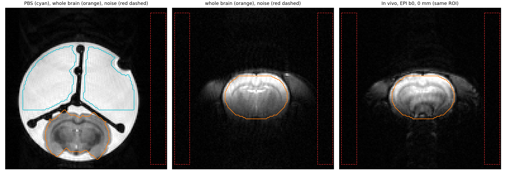

## Frequency recovery and off-centre phase calibration

A/B is the direct ex-vivo bandwidth check: the relative readout shift is −0.05 pixel, equivalent to a nominal −16 Hz under the tool's conversion and uncalibrated sign convention. It passes the planned 0.5-pixel limit. Subpixel registration is sensitive to interpolation and contrast (ESP differs), so this is not a direct frequency measurement or spatial B0 map. Together with restored b-dependent signal in C/O/R, it strongly supports recovery from the approximately 2.83-kHz error seen on 11 October. It does not prove that frequency was the only earlier failure mechanism.

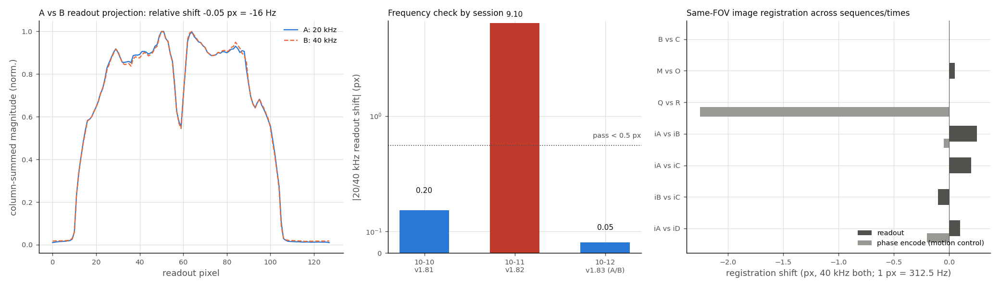

The D/E/F/G navigator fit separates linear echo-to-echo ramp from odd/even alternation. The existing calibration criterion is absolute ramp ≤5°/echo and alternation coefficient ≤5°. Both signs of slice offset must pass.

| Scan, setting | Ramp at −1.2 / +1.2 mm (°/echo) | Alternation at −1.2 / +1.2 mm (°) | Result |
|---|---:|---:|---|
| D, mode 0 | −0.2 / +0.1 | −12.6 / +14.8 | Ramp small; alternation fails |
| E, mode 1, phcal 0 | −49.7 / +49.9 | +21.0 / −24.0 | Both fail |
| F, mode 1, phcal +530 | −0.9 / +0.8 | +5.7 / −8.7 | Ramp corrected; alternation still fails |
| G, mode 1, phcal −530 | +81.8 / −82.2 | −44.1 / +40.2 | Both fail |

**The corrective sign is positive.** Interpolation gives ramp-zero values near +538/+539 and a rounded candidate of **+540 ticks**. That setting was not acquired. It is a candidate for validation, not a certified calibration. Since +530 already reduces the ramp below 1°/echo but leaves alternation, adjusting a single ramp parameter is unlikely to address every artifact.

Banding persists even after the ramp improves. Navigator phase can explain part of the image modulation, but spatially varying RF phase, slice-profile effects and echo amplitude modulation remain candidates. D mode 0 also has near-zero ramp with residual alternation, so mode 0 should not be considered fully calibrated. This sweep tests one ex-vivo sample at ±1.2 mm, not every offset or in-vivo coil condition. [Detailed phase methods and fits](data/oct12_phase_FINAL.md) preserve alias handling, residuals and limitations.

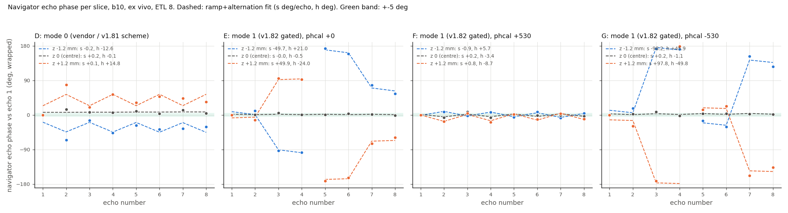

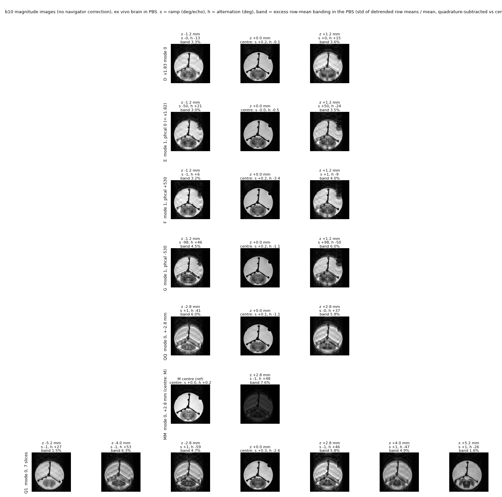

## Navigator layout, recovery and correction

Scan N is recoverable. Its header reserves 153 views per volume, but the acquired stream contains 119: seven volume-navigator echoes and 16 shots of seven imaging echoes. In the v1.83 source, PPL TRUE evaluates to −1; the nav-mode-2 echo calculation therefore omits the eighth imaging echo and the per-shot navigator. The recovered reconstruction uses the actual 119-view volume boundaries and places the acquired imaging lines on the scanner's 128-row grid. Sixteen outer ky lines remain explicitly zero-filled. A compact 112-row reconstruction has the same acquired ordering after an eight-row origin shift, but different pixel spacing. Neither representation restores missing data.

Recovered N-to-M object correlations are **0.988, 0.987, 0.976 and 0.971** at b10, b1000, b3000 and b6000; NRMSE is 0.065, 0.082, 0.089 and 0.100. The ordinary header-based split gave correlations only 0.40–0.24. This diagnoses the gross reconstruction failure, while leaving the missing lines and absent per-shot navigator as acquisition defects. [Recovered image and complex k-space](data/oct12_N_recovered.npz) include the acquired-row list and reconstruction metadata.

N and R also have a verified phase-encode scaling error: the source/protocol combination produces a 1.125× phase-gradient step, hence approximately **31.1 mm phase FOV instead of 35 mm**. Free image scale fits support this prediction (R median 0.892 versus expected 0.889). Geometry-aware R ROIs are used in the audited quantitative results. An apparently compressed image should not be treated as improved resolution.

R contains usable per-shot navigators, but correction benefit is mixed. The normalized excess phase-encode background metric is lower when better. At the centre slice, its b1000 mean is 0.0116 uncorrected, 0.0127 with the shipped constant-plus-linear correction and 0.0056 with constant-only correction. At b3000 these values are 0.0118, 0.0100 and 0.0081. Off-centre, shipped correction worsens the b1000 mean from 0.0178 to 0.0416; an SNR≥8 gate suppresses those unreliable corrections. Constant-only is promising in this small set, but repeated scans and an independently validated motion measure are needed before selecting it universally.

Ex-vivo v1.912 generally has less measured excess background than v1.83 in the available centre-slice comparisons. This is descriptive: scans are not all paired, N/R geometry differs, and high-b background includes the attenuated PBS-filled tube. In vivo iA b3000 y has a large metric (0.144), while corresponding ss-MGOT is below the reliability threshold. A low apparent ghost metric at very low signal does not establish a cleaner usable image.

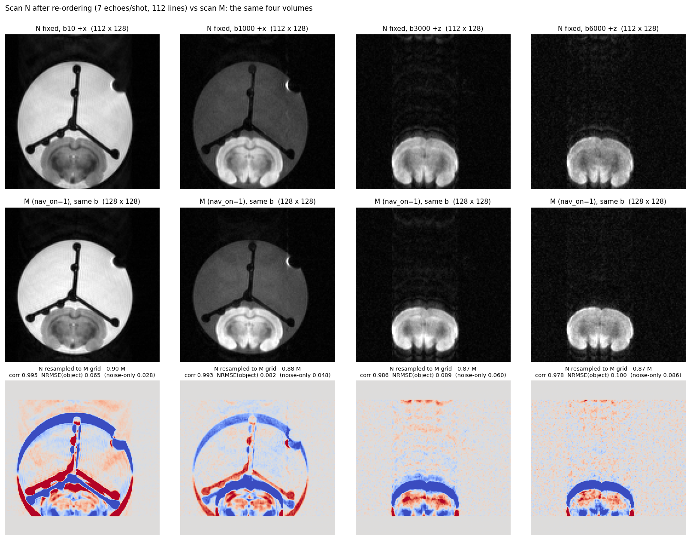

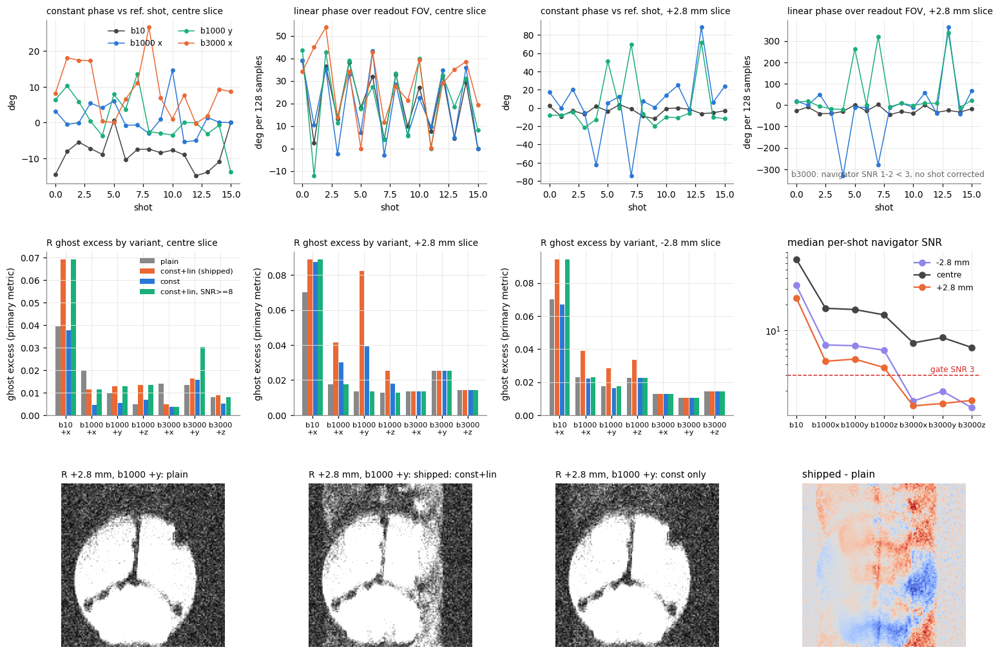

[Navigator methods, individual results and limitations](data/oct12_nav_FINAL.md) preserve masks, reliability gates and the two passing layout regression checks.

## Signal and SNR

| Central-slice baseline SNR | v1.83 | v1.912 | EPI |
|---|---:|---:|---:|
| Ex-vivo free PBS | Q 117.6; M 118.7 | R 37.6; O 43.7 | 111.3 |
| Ex-vivo whole brain | Q 62.4; M 67.7 | R 17.0; O 20.6 | 56.1 |
| In-vivo whole brain | iA 46.8 | iB 11.9; iC 13.2 | 56.8 |

EPI gives higher raw in-vivo SNR while using thicker slices. At the acquired geometries v1.83 SNR/sqrt(time) is about 8.0 versus EPI 8.2, so their baseline time efficiency is nearly equal before voxel normalization. ss-MGOT is about 2.0. Its much larger signal penalty cannot be explained by volume timing alone.

The final audit preserves measured SNR while separating efficiency conventions. EPI's original calculation used a 35/168-mm read pixel for voxel normalization, even though ROI signals came from a resampled 128-column grid. Using the 128-column 35-mm display grid changes EPI voxel volume from 0.1139 to 0.1495 µL and in-vivo normalized efficiency from 71.9 to 54.8 SNR/√s/µL. v1.83 is 107.3 on its 128-column, 1-mm grid. Thus the nominal ratio is about 1.49 under the native-grid convention and 1.96 under the ROI-grid convention. Neither is an independently measured matched-resolution advantage: effective read resolution, vendor filtering and noise correlations remain unresolved. The earlier exact 1.5× statement should be read as one normalization convention, not a certified efficiency ratio.

R also has a phase FOV mismatch. Using the source/protocol phase FOV of 31.11 mm gives voxel volume 0.06646 µL rather than 0.07477 and whole-brain normalized efficiency 43.91 rather than 38.61. The ROI transform separately uses the measured R-to-Q scale of 0.8925. Its geometry-aware brain SNR remains 17.0 versus Q 62.4, so the large signal gap persists. R's baseline-to-b1000 arithmetic mean effective ADC is 0.3727 versus Q 0.3246; this interval differs from the high-b pair reported below. [Quantitative audit](data/oct12_quant_FINAL.md) and [audited rows](data/oct12_quant_audit.csv) retain both the original and corrected conventions.

In vivo at b1000, v1.83 whole-brain SNR is 22–24, EPI 25–28 and ss-MGOT 5.7–6.4. At b3000 these ranges fall to 7.9–9.6, 9.0–10.6 and 1.8–2.7 respectively. At b6000 v1.83 and EPI have whole-brain SNR around 4, while ss-MGOT is around 0.8–1.0. Deep voxels can perform worse than these ROI averages. High-b estimates must therefore carry a noise/quality mask, especially for ss-MGOT. Magnitude-noise bias in diffusion measurements is an established issue [Jones and Basser, 2004](https://doi.org/10.1002/mrm.20283).

A/B has ex-vivo brain SNR 91.1/65.7 and PBS 159.2/120.2: gains of 1.39 and 1.32 at half bandwidth, reasonably close to sqrt(2). ESP changes too (14 vs 11 ms), so this is not a pure bandwidth experiment. Lower bandwidth can improve SNR but increases frequency displacement sensitivity and lengthens the readout.

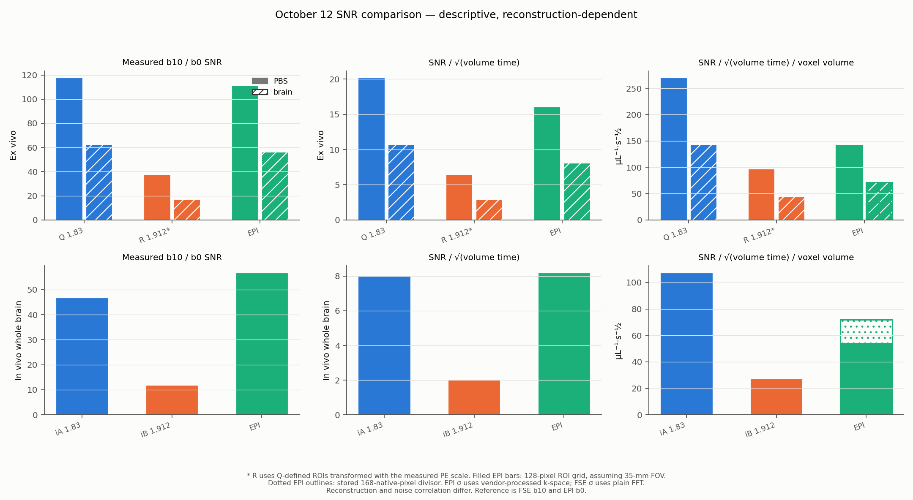

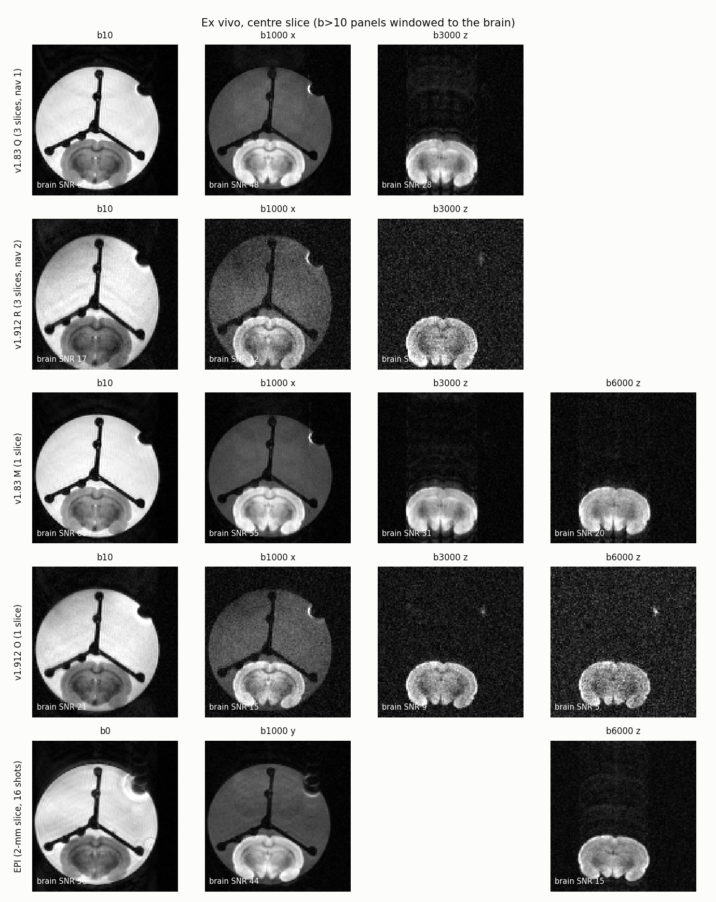

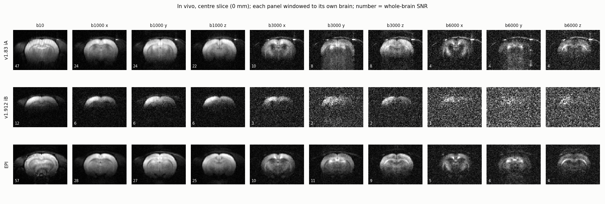

## ADC in PBS, brain, directions and space

PBS is the useful isotropic control at b10 to b1000, where residual signal remains measurable. In Q, source-model-corrected central-slice ADC is x 1.772, y 1.832 and z 1.908. In the geometry-audited R mask it is 1.830, 1.822 and 1.867. Across Q/Q1/R, x/y mostly occupy 1.77–1.92 and z 1.86–1.92. A small residual directional discrepancy remains after modelling. A z-gradient calibration error is possible, but waveform modelling, eddy currents, reference-direction differences and ROI artifacts are alternatives. Absolute agreement with water/PBS theory requires measured sample temperature and composition. Do not calibrate the gradient from this one observation alone.

The earlier off-centre +20% discrepancy is not reproduced as a systematic increase: PBS ADC remains relatively stable through ±5.2 mm. Individual direction/slice deviations are several percent rather than exactly zero. This is reassuring for regional ROI diffusion attenuation, but it does not validate image homogeneity or voxelwise ADC; horizontal banding remains a separate failure mode. High-b PBS is near the noise floor and its apparently reduced ADC must not be interpreted as restricted diffusion.

For ex-vivo brain, mean b1000-to-b3000 ADC is Q 0.2333, Q1 0.2325 and geometry-audited R 0.2306. Q versus R differ by **1.2%**, a close agreement rather than identity. The legacy translation-only R mask gave 0.2397 (2.7% above Q); correcting its physical ROI changes that estimate. The sequence and navigator conditions still differ, and no formal equivalence test was performed. The low-b x ADC changes from M 0.296 (one slice) to Q 0.322 (three slices) and Q1 0.350 (seven slices), while baseline brain SNR falls from 67.7 to 62.4 to 51.2. PBS signal/SNR is more stable. The pattern supports tissue-specific RF saturation, MT or slice-profile effects, but there is no direct MT measurement. Time order, gains and slice placement also differ. Stable high-b slopes reduce the likelihood of a simple global diffusivity change but do not rule out temperature drift.

| In-vivo brain ADC interval | v1.83 iA | v1.912 iB | EPI |
|---|---:|---:|---:|
| Baseline to b1000, three-axis mean | 0.689 | 0.679 | 0.774 |
| b1000 to b3000 x | 0.465 | 0.447 | 0.483 |
| b1000 to b3000 y | 0.565 | 0.591 | 0.459 |
| b1000 to b3000 z | 0.498 | 0.481 | 0.511 |
| b1000 to b3000 mean | 0.509 | 0.506 | 0.484 |

FSE values in this table use modeled effective b, and EPI uses nominal b. The high-b FSE/EPI means differ by **5.2%** for v1.83 and **4.6%** for v1.912. This is encouraging cross-protocol consistency at the ROI level. It is not an equivalence test: no independent scan repeats or uncertainty interval support a formal equivalence margin, and ss-MGOT b3000 is particularly noisy.

The FSE y high-b slope exceeds x by about 21% in iA and 32% in iB. EPI does not show the same pattern. Motion/shot phase, diffusion-gradient eddy currents, spatial weighting and direction metadata need investigation before treating this as tissue anisotropy. Anatomical axes are not inferred from logical x/y/z labels. EPI's embedded direction array disagrees with the vendor btable, which lists +x throughout; without the EPI PPL or sequence log, actual played directions remain provisional.

The ex-vivo EPI test0 acquisition contains only b0, b1000 +y and b6000 +z. Its baseline-to-b1000 single-direction brain ADC is 0.273 and PBS ADC is 1.792. There is no ex-vivo EPI three-direction mean or b1000-to-b3000 measurement; different-direction b1000/b6000 images cannot supply a same-direction high-b slope.

EPI's larger in-vivo baseline-to-b1000 ADC can plausibly reflect b0 versus b10, thicker-slice CSF partial volume, perfusion and contrast weighting. These effects were not separately measured, so attributing the difference entirely to perfusion/CSF is too strong. Declining ADC with higher b can reflect non-monoexponential tissue signal, but the growing noise floor and artifacts also lower apparent ADC. A fitted single ADC over the entire b range would obscure these different regimes.

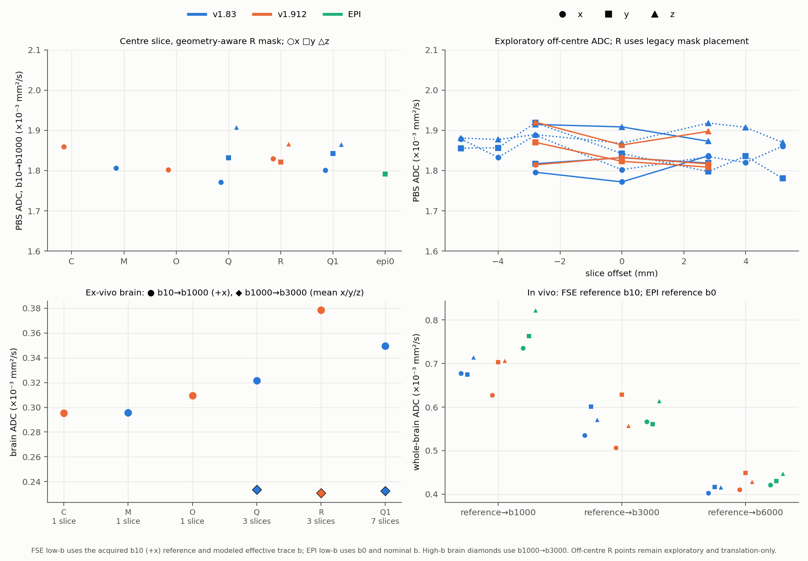

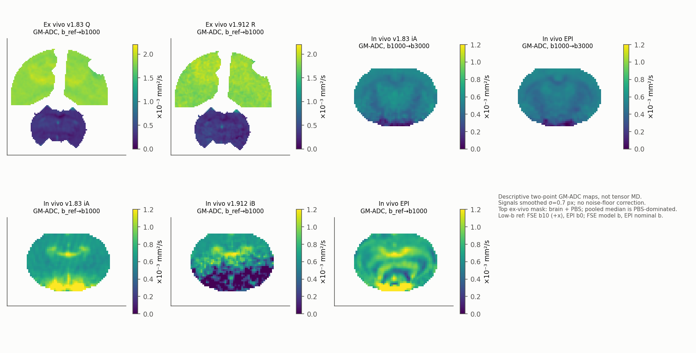

Map values above are visualizations, not the ROI estimator. They smooth magnitude before taking logs and have no fully validated spatial noise correction. Ex-vivo display masks include PBS as well as brain, so a median of the combined mask is not brain MD. ss-MGOT high-b maps particularly require quality masking. Read spatial texture alongside the source images and SNR, not as an independently validated biomarker.

### Unsmoothed voxelwise ADC with explicit signal censoring

The additional quality-map analysis averages the three directional voxelwise log slopes for baseline-to-b1000 and b1000-to-b3000. FSE uses modeled echo-1 effective-b traces; EPI uses typed b. Each raw-magnitude endpoint must exceed five times that volume's side-background sigma. No smoothing or magnitude-noise subtraction is applied. The mask is a conservative signal gate, not an unbiased ADC estimator, and retained voxels are not representative of the entire brain when coil sensitivity determines selection. EPI interpolation and reconstruction noise correlations remain a limitation.

For in-vivo iA, 89.2% of the original whole-brain ROI passes at low b and 51.8% at high b. For iB the fractions are 21.9% and 1.1%; for EPI-invivoA, 92.4% and 68.5%. The near-empty high-b ss-MGOT map is an honest representation of insufficient signal, rather than evidence of absent diffusion. Coverage percentages should accompany every map, and map medians should not replace the whole-brain ROI signal estimator.

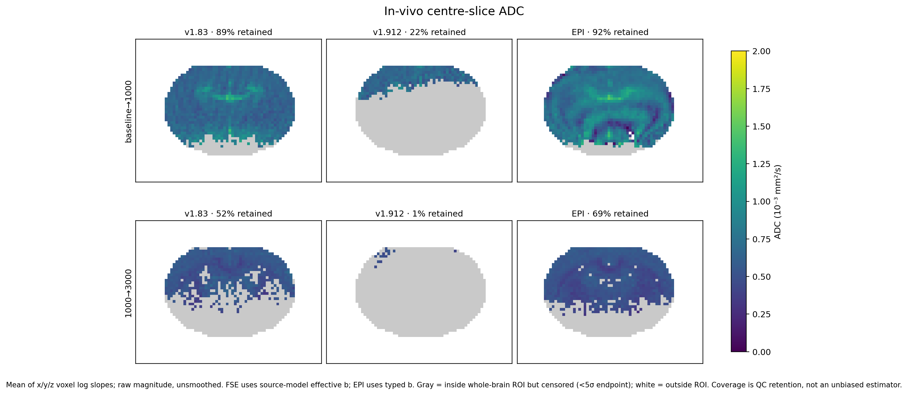

Ex vivo, the Q whole-brain mask retains 99.93% at low b and 99.71% at high b; geometry-aware R retains 94.04% and 69.42%. Free-PBS low-b retention is 100% in Q and 49.59% in R, while neither has passing PBS voxels at the high interval. This supports using PBS for low-b control only in these data. EPI test0 lacks the required three-direction shells and b3000, so no equivalent map is generated.

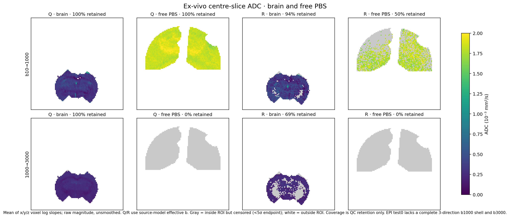

[Map definitions, coverage and voxel arrays](data/oct12_adc_quality.json) preserve the threshold, sigma convention and b denominators.

## Diffusion weighting across the echo train and k-space

The event model predicts extra diffusion weighting later in the train. For Q/iA, b10 trace increases from 14.4 at echo 1 to 79.8 s/mm² at echo 8. The b1000 x trace increases from 1000.6 to 1066.0. For R, corresponding b10 traces are 30.7 to 113.0 and b1000 x traces 1014.0 to 1096.3. The ETL 16 iF baseline increases from 13.9 to 146.6 by echo 16. These are pathway-model predictions, not measurements of the scanner gradients.

In the simple single-pathway model, the added trace within a given train is nearly the same for baseline and diffusion-weighted volumes. Much of it therefore cancels in an echo-matched ADC denominator. It can still change image contrast and the k-space weighting through relaxation, tissue composition and stimulated pathways. A rising raw b-value across echoes does not automatically imply a similarly rising true ADC. Centric ordering couples echo number to sampled k-space, so unequal baseline/DWI echo modulation can produce spatially dependent apparent ADC and blur even if the centre-echo ROI slope looks reasonable.

Navigator-derived echo ratios can test whether attenuation stays constant over a train, but unencoded readout projections mix brain and PBS along the phase axis. A projection-column label is not a tissue-isolated ROI. A Fourier-band ratio also measures spatial contrast and cancellations rather than a local tissue ADC. The completed navigator analysis distinguishes these diagnostics from tissue-property estimates. In vivo iA b6000 total navigator ADC is almost flat over the train (later echoes about 1–2% lower), while imaging k-band ADC falls about 34–42%. At ex-vivo b6000 z, M's total navigator ADC rises 26.5% and O's rises 3.7%, while their k-band estimates fall 4.3% and 14.9%, with only five and four usable echoes. At b3000, Q total/brain-column navigator ADC rises roughly 15–27% while k-band ADC is close to flat; R total ADC is nearly flat but k-band ADC falls 13–19%. These differing trends demonstrate echo/k-space dependence of the measured signal and estimator; they do not demonstrate a change in intrinsic tissue diffusivity. High-b noise censoring, spatial mixtures and Fourier cancellation limit interpretation.

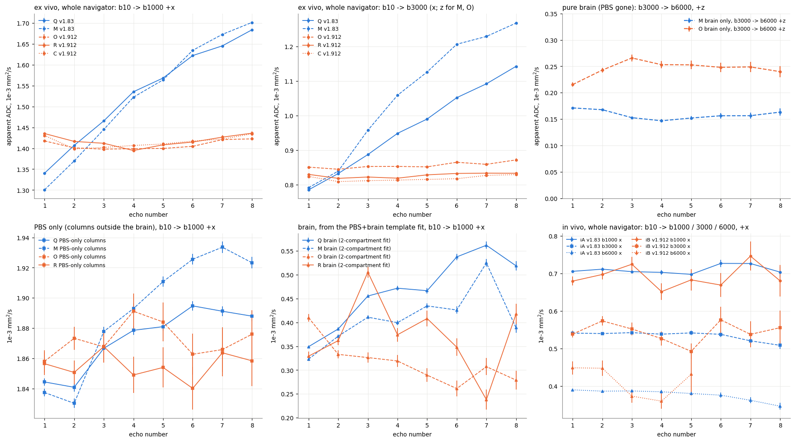

## ss-MGOT amplitude asymmetry under the surface coil

The dorsal image left/right intensity ratio is 0.82 for iA, 1.55 for iB and 1.58 for iC. The opposite trend persists at intermediate depth. ss-MGOT/v1.83 reaches roughly 0.51 at its strongest region but declines sharply with depth. The saved depth profile is a row-mean magnitude/noise measure: at about 3.0 mm iB is about 11, at 4.1 mm about 5.6, and around 6–8 mm it approaches the magnitude-noise floor. This supports a depth-limited quantitative performance problem, not a universal hard 3-mm cutoff.

If coil geometry, receive scaling and registration are stable, dividing iB by iA partly cancels shared receive sensitivity. It does not remove excitation, refocusing, MT, saturation or sequence-dependent phase effects. Equal v1.83 magnitude also does not uniquely identify equal receive B1. The flat reconstructed phase difference in the bright region (SD about 0.066 rad) makes a large final-image phase mismatch less likely there, but cannot exclude a phase error earlier in the preparation that has already reduced magnitude.

Transmit B1 sensitivity is physically plausible, and transmit/receive asymmetries can differ at high field [surface-coil field study](https://pmc.ncbi.nlm.nih.gov/articles/PMC5082994/). The side and strength of the skew for this rat/coil were not mapped. Neither global registration nor magnitude ratio rules out local off-resonance, RF pulse bandwidth or slice-profile contributions. A measured B1+ map and B0 map, registered to these scans, would distinguish these mechanisms.

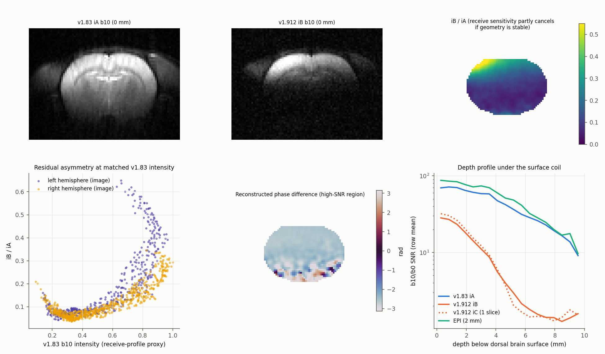

## B1 sensitivity simulation: support, not causal proof

The completed sensitivity study combines a full ideal-pulse EPG sweep (transmit scale κ = 0.30–2.00, step 0.01) with 44 targeted sequence-level Bloch cases. Assumed tissue parameters are T1 = 1.9 s and T2 = 45 ms, with TE 44 ms and ESP 11 ms. These are simulation inputs, not relaxation measurements from this animal. Bloch uses the repository event mapper and finite RF/slice profiles on a reduced spatial grid; EPG uses instantaneous pulses and follows the main recalled branch. Neither model includes a measured B1 field, receive sensitivity, MT or the full in-vivo physiology.

The intrinsic stabilizer factor is validated: stored/prepared branch amplitude is 0.4985 after the simulated storage interval. **The complete sequence image ratio is not expected to be exactly one-half.** At κ = 1, ss-MGOT/v1.83 echo-1 ratio is 0.3494–0.3544 in EPG and 0.3620 in Bloch. Targeted Bloch reaches 0.467 at κ = 1.2. These assumptions do not exactly reproduce the observed strongest ratio near 0.51. Tissue T2, RF calibration, different slice/RF burden and reference weighting can change that comparison, so agreement with a nominal half-factor is not a mechanism test.

| Assumed transmit scale κ, B0 = 0 | Targeted Bloch ss-MGOT/v1.83 ratio |
|---:|---:|
| 0.40 | 0.0137 |
| 0.50 | 0.0447 |
| 0.70 | 0.1456 |
| 1.00 | 0.3620 |
| 1.20 | 0.4670 |

The model can produce a roughly tenfold ratio drop between κ = 1.2 and 0.5. That demonstrates strong sensitivity to an assumed field reduction; it does not establish that this 58% change actually occurred with depth. Correcting the observed left/right contrast for the v1.83 reference gives a normalized ratio about 1.89–2.07. Ideal EPG can produce about 1.98 with a 22–32% κ difference in a low-field regime (right-side κ = 0.4–0.6), but cannot reach it from every starting κ. A scalar sensitivity curve therefore cannot uniquely recover a spatial B1 map from the images.

Uniform ±100-Hz offset changes the modeled ratio by about 9.6% at κ = 0.7 and 1.8% at κ = 1.0. This is smaller than the observed order-of-magnitude depth loss for those particular conditions. It strengthens the B1-sensitivity hypothesis under modest global off-resonance, while leaving local B0 variations and slice-profile effects unresolved. There is no acquired in-vivo field map to validate the assumed offset range.

**Interpretation:** transmit-B1 sensitivity is a credible contributor to the ss-MGOT depth loss and asymmetry. The images and simulations do not uniquely establish it as the cause, prove the skew direction, or establish a hardware-independent 3-mm usable-depth cutoff. Quantitative whole-brain use with this surface coil remains poorly supported because high-b deep signal is already near the noise floor.

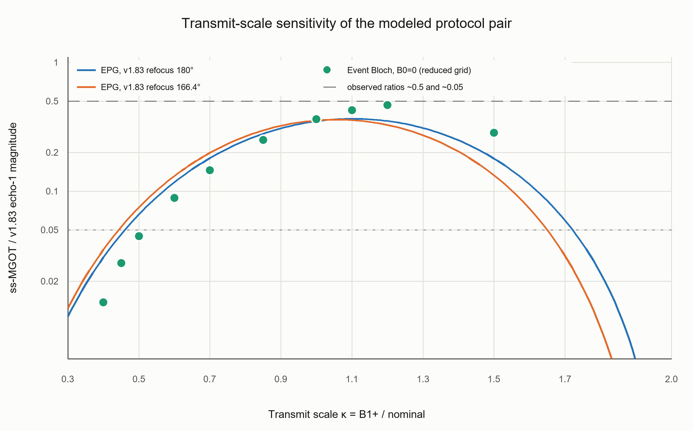

[Simulation methods and limitations](data/oct12_b1_FINAL.md), [numeric CSV](data/oct12_b1_targeted.csv) and [model/source details](data/oct12_b1_targeted.json) allow inspection and reproduction. The targeted calculation replaces the incomplete exhaustive grid; dense fitting of B1 to the observed images was not performed.

## ETL 16 versus ETL 8

The matched iE/iF comparison changes ETL at fixed recorded TR, TE, slice thickness and diffusion separation. Baseline whole-brain SNR is 77.26 versus 60.54, a **21.6% loss**. Volume time falls from 51 to 27 s. At the baseline, SNR/sqrt(time) increases by **7.7%**. At b6000 y, SNR is 6.76 versus 5.16 and normalized efficiency increases by only **5.0%**. Thus the time benefit is real, but the noise-efficiency gain is modest.

Measured b10 navigator echo decay predicts phase-encode PSF FWHM 0.444 versus 0.581 mm, **30.8% broader**. Energy beyond two pixels approximately doubles (4.6% versus 9.4%). This is a navigator-derived PSF model, not a direct resolution phantom measurement, and it assumes the navigator train represents encoded tissue signal. RF pathways, phase modulation and high-b weighting can make the actual PSF differ.

The largest relative SNR loss occurs near the coil, consistent with an RF-dependent effect. More refocusing pulses per shot, shorter per-volume recovery and overlapping slices can produce saturation/MT/cross-talk, but these have not been separated. Total imaging refocusing pulses per volume do not simply double when ETL doubles, because the number of imaging shots halves. The source-model centre-echo b is essentially unchanged, so a b-value change does not explain the baseline penalty.

Choose ETL 8 for fine anatomy and stable quantitative comparison. Choose ETL 16 when halving scan time is worth the predicted blur and about 22–24% SNR loss. These scans contain only baseline and b6000 y, so they do not establish ETL equivalence for a multi-direction ADC or tensor protocol.

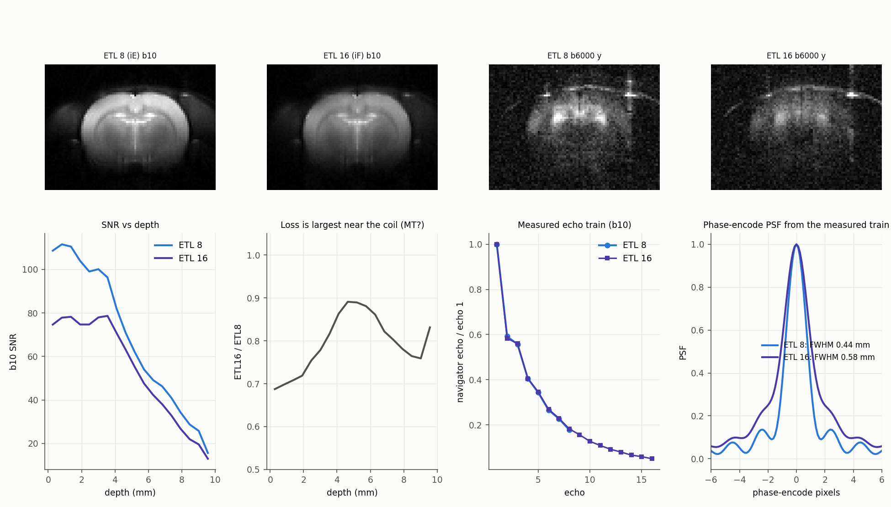

## Remaining FSE failure modes and next experiments

A bright scalp arc/spot in vivo persists at b6000 with about 55% signal retention (apparent ADC near 0.1), consistent with unsuppressed fat. Its location and persistence support the assignment, but a fat-suppression toggle or chemical-shift test would confirm it. High-b fat can contaminate nearby brain through streaks even when excluded from the ROI. **Enable and validate CHESS for in-vivo v1.83** with a matched on/off comparison. The current EPI suppresses this signal, while ss-MGOT's absence of it could reflect prep bandwidth as well as lower signal. CHESS is itself B0/B1-sensitive and must be checked under the surface coil. Ex vivo, fat suppression should follow observed lipid contamination rather than be assumed necessary for the PBS sample.

The next session should hold geometry, TE/TR where feasible, directions, receiver gain and reconstruction fixed, and compare protocols at matched coverage and resolution. Measure temperature for PBS ADC, archive centre frequency and scanner PPL build, acquire B0/B1 maps, and repeat selected directions to separate physiological motion from reproducible direction bias. A small isotropic phantom with reversed diffusion gradient polarities can test residual cross terms/calibration. Repeated baseline scans provide empirical SNR and drift checks that single-background estimates cannot.

For v1.83 phase calibration, validate the candidate near +540 on both signs of slice offset, then treat odd/even alternation separately. For ss-MGOT, test transmit gain sweeps or a more B1-robust preparation with the volume coil before additional whole-brain surface-coil studies. Diffusion-prepared FSE literature illustrates stabilizer and B1-robust preparation approaches, but those designs do not validate this implementation [diffusion-prepared RARE study](https://pmc.ncbi.nlm.nih.gov/articles/PMC8369385/).

## Reproducibility and evidence

The catalog is the acquisition record. The final report is the interpretation; measured data and source-model outputs remain separately labelled in CSV/JSON. The original MRDs remain unchanged. No scanner deployment or sequence rewrite follows from these recommendations.

Core files: [ROI signal table](data/oct12_roi_signals.csv), [ROI ADC summary](data/oct12_roi_results.json), [effective-b table](data/oct12_effective_b.csv), [effective-b model details](data/oct12_effective_b.json), [phase measurements](data/oct12_phase_calibration.csv), [navigator measurements](data/oct12_navigator_echoes.csv), and [protocol audit](data/oct12_protocol_audit.json). Scripts in docs/data/oct12_*.py reconstruct these analyses from session data. Figure captions and discussion state when quantities are measured, modelled or hypothesis-driven.

